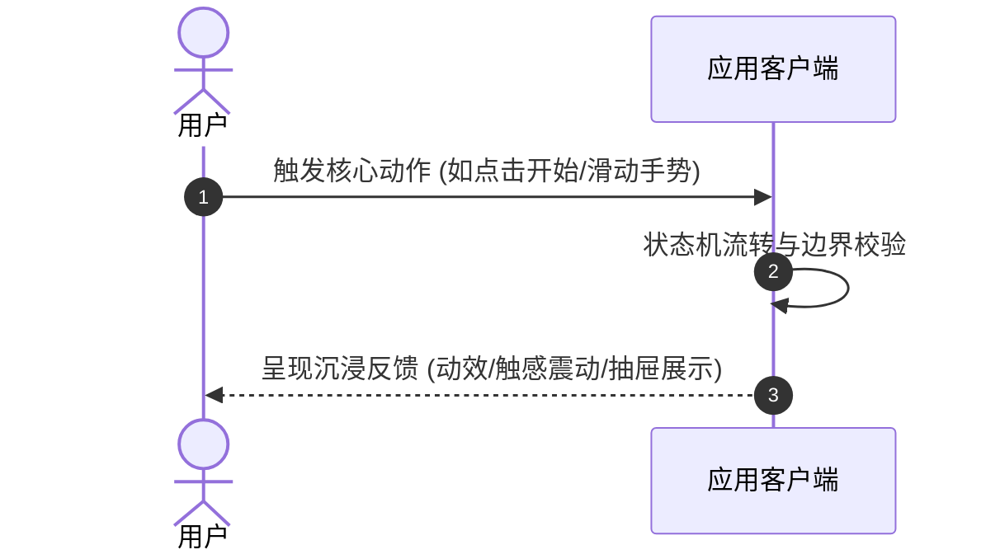

# [项目标识]_PRD_[功能/模块描述]_v[版本号]

| 文档版本 | 编写人 | 评审人 | 状态 | 更新日期 |
| :--- | :--- | :--- | :--- | :--- |
| v1.0.0 | [产品负责人] | [架构师/技术负责人] | 草稿 / 评审中 / 已发布 | YYYY-MM-DD |

---

## 一、需求背景与业务目标

### 1.1 现状痛点
> 详细描述当前系统、用户流程或交互体验中存在的核心阻碍与负向反馈。

### 1.2 业务目标与价值
> 阐明本次功能演进或重构的核心诉求（如提升小屏加载流畅度、增加多场景沉浸互动、降低跳出率等）。

---

## 二、目标用户与交互场景

### 2.1 典型用户角色 (User Persona)
- **核心角色 A**：特征描述、使用场景与核心敏感点；
- **核心角色 B**：双人互动或协同配合角色。

### 2.2 用户旅程时序 (User Journey)

---

## 三、功能矩阵与需求拆解

| 优先级 | 功能模块 | 核心功能点 | 体验与交互细节 | 关联切片 |
| :--- | :--- | :--- | :--- | :--- |
| **P0 (Must)** | [模块 1] | 核心机制升级 | 明确手势防抖、状态响应要求 | Slice 1 |
| **P1 (Should)**| [模块 2] | 交互抽屉与视觉 | 毛玻璃模糊度、自适应安全区 | Slice 2 |
| **P2 (Nice)**  | [模块 3] | 降级机制与兜底 | 无痕模式、异常数据重置 | Slice 4 |

---

## 四、人机工效与视觉交互标准

1. **拇指热区与单手操作**：高频点击按钮必须位于屏幕下半区 40% 高度以内；
2. **小屏视口极限压测**：必须在 iPhone SE (375x667) 等极端尺寸下无垂直截断；
3. **触感与多模态反馈**：核心操作（翻牌/确认）需伴随毫秒级微震动与缓动动效。

---

## 五、验收标准与交付物定义

- [ ] 所有 P0 / P1 功能点在真机与 Web 端均能顺畅闭环；
- [ ] 自动化测试套件覆写率达标，无回归问题；
- [ ] 对应技术方案 (TECH)、维护手册 (Handbook) 与 QA 报告完成同步归档。
