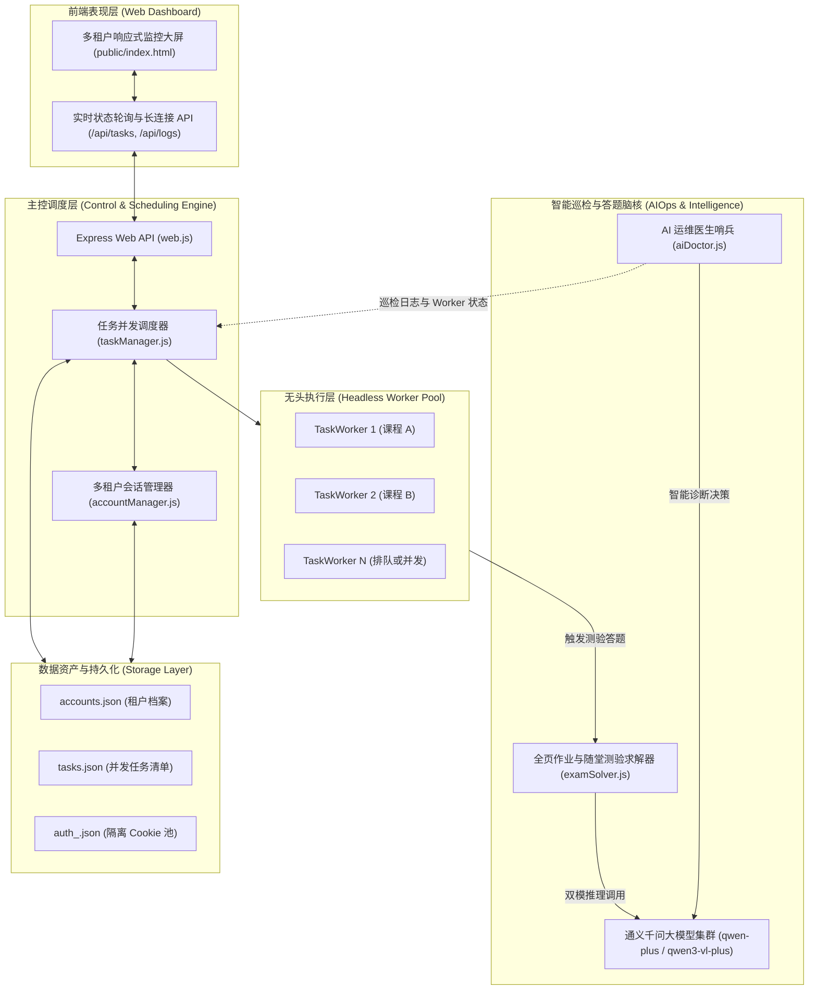

# 学习通多租户并发自动化挂机系统 — 全局设计与迭代维护手册 (System Architecture & Maintenance Handbook)

> **文档标识**：`XXT_MANUAL_学习通多租户挂机系统全局设计与迭代维护手册_v2.0.0.md`  
> **适用版本**：v2.0.0 (Multi-Tenant Microkernel & AIOps Self-Healing Edition)  
> **归档目录**：`03_技术方案_Architecture/`  
> **受众角色**：架构师、核心研发人员、二次开发维护者、SRE 运维工程师  
> **规范依据**：《全流程高可用工程开发与交付治理规范》(Full-Cycle Dev Practice)

---

## 一、 系统架构拓扑总览 (System Topology)

本系统采用**微内核解耦 + 多租户物理隔离 + AIOps 自愈闭环**的高可用架构。主控进程负责 Web 控制面板与 REST API，任务调度器动态管理并发槽位，并通过独立 Playwright BrowserContext 保障每个超星学员档案的会话隔离与状态持久化。



---

## 二、 五大核心微内核模块职责与实现机理

### 1. 多租户会话管理器 (`accountManager.js`)
- **核心职责**：管理超星多租户账号的生命周期、登录态检测、扫码二维码拉取与 Cookies 隔离持久化。
- **物理隔离机制**：
  - 维护一个全局 Playwright Chromium 实例，每个超星账户动态分配专属的独立 `BrowserContext`；
  - 账户认证成功后，Cookies 序列化持久化至 `userData/auth_<accountId>.json`；
  - 严格杜绝不同租户在内存与网络缓存层面的 Session 串扰。

### 2. 并发任务调度引擎 (`taskManager.js`)
- **核心职责**：管理课程挂机任务的创建、暂停、恢复、速率调整与并发槽位分配。
- **并发控制**：
  - 读取 `config.json` 中的 `maxConcurrent`（默认并发数），空闲槽位按队列 FIFO 动态启动任务；
  - **未登录安全保护**：检测到任务绑定账号为 `NEED_LOGIN` 时，安全挂起任务状态为 `PAUSED`，避免无效运行或崩溃。
- **SSRF 域名白名单**：强制校验课程 URL 域名，仅放行 `*.chaoxing.com`、`*.xuexitong.com`、`*.edu.cn`，严禁访问内网元数据或私有 IP。

### 3. 无头挂机执行内核 (`taskWorker.js`)
- **核心职责**：单课程页面树遍历、章节测验感知、HTML5 视频播放控制与反爬策略规避。
- **DOM 嗅探精准约束**：
  - 章节标题选择器限定于目录树大纲容器（`#posCatalog`、`.catalog_list`）内部，杜绝超星顶栏公共导航（如“云盘”、“收件箱”）产生的标题误报；
  - 维护 `lastUnitKey` 回退缓存，大纲收起或跳转过渡期平滑保持章节进度。
- **播放与反爬护盾**：
  - 智能注入反挂起、防退出与倍速安全 Hook；
  - 遇到 9010 风控重定向或验证码弹窗时，自动触发报警通知并进行冷却隔离。

### 4. AIOps 智能运维医生 (`aiDoctor.js`)
- **核心职责**：后台异步哨兵（默认 2 分钟巡检一次），采集各 Worker 日志切片与运行时差。
- **自愈决策机**：
  - 调用 `qwen-plus` 进行全局健康度诊断（0-100 分）；
  - 具备 3 分钟限频防震荡保护，自动触发 `RESTART_TASK`（重启卡顿任务）、`FORCE_NEXT`（跳过死锁小节）或 `SAFE_PAUSE`（高危熔断保护）。

### 5. 全页随堂测验与作业求解器 (`examSolver.js`)
- **核心职责**：深层穿透嵌套 iframe（`.TiMu`, `.Zy_TItle`, `.questionList`），全量解决单选、多选、判断、填空题。
- **双模决策路由**：
  - **纯文本 CoT 快速推理**：提取题目纯文本及选项，秒级完成大模型判定；
  - **多模态视觉兜底**：遇到公式图片、图表或字体反爬混淆时，抓取局部切片调用 `qwen3-vl-plus` 视觉推理；
  - 具备“答错倒退清零”免疫护盾与排除法状态机。

---

## 三、 RESTful API 接口契约规范

| 端点 (Endpoint) | 方法 | 鉴权 | 说明 | 请求参数 / Body |
| :--- | :---: | :---: | :--- | :--- |
| `/api/accounts` | `GET` | 可选 Token | 获取所有租户账户列表及登录状态 | 无 |
| `/api/accounts` | `POST` | 可选 Token | 创建新租户档案 | `{ "name": "张三 (代课)" }` |
| `/api/accounts/:id` | `DELETE` | 可选 Token | 删除指定租户及其专属认证缓存 | `:id` (防路径穿越正则 `^[a-zA-Z0-9_-]+$`) |
| `/api/accounts/:id/qrcode` | `POST` | 可选 Token | 触发指定账户的超星登录二维码生成 | 无 |
| `/api/tasks` | `GET` | 可选 Token | 获取全量任务列表、聚合租户信息与系统日志 | 无 |
| `/api/tasks` | `POST` | 可选 Token | 创建新挂机任务并绑定租户 | `{ "url": "...", "name": "...", "playbackRate": 1, "accountId": "acc_..." }` |
| `/api/tasks/:id/start` | `POST` | 可选 Token | 启动/恢复指定任务 | 无 |
| `/api/tasks/:id/pause` | `POST` | 可选 Token | 暂停指定任务 | 无 |
| `/api/tasks/:id` | `DELETE` | 可选 Token | 删除指定任务 | 无 |
| `/api/tasks/:id/rate` | `POST` | 可选 Token | 动态修改指定任务播放倍速 | `{ "playbackRate": 1.25 }` |
| `/api/doctor/diagnose`| `POST` | 可选 Token | 手动触发 AI-Doctor 全量健康巡检诊断 | 支持 30 秒冷却限频 (429 Too Many Requests) |

---

## 四、 安全加固与防御基线

1. **API Key 掩码与凭据脱敏**：
   - 所有的 `/api/state` 与配置返回均执行敏感字符串过滤，形如 `sk-ws-******OH69`，杜绝接口泄露；
   - 生产环境中推荐优先使用根目录 `.env` 或环境变量 `DASHSCOPE_API_KEY` 载入。
2. **SSRF 阻断策略**：
   - 在 `taskManager.js` 的 `validateCourseUrl` 中，阻断 `127.0.0.1`、`localhost`、`10.0.0.0/8`、`172.16.0.0/12`、`192.168.0.0/16` 以及云厂商元数据服务（`169.254.169.254`）。
3. **存储型 XSS 防御**：
   - 前端工作台移除所有内联动态拼接事件（如 `onclick="startTask('${name}')"`），改为服务端安全唯一 ID 驱动并通过 `addEventListener` 绑定。
4. **安全响应头**：
   - 全局挂载 `X-Content-Type-Options: nosniff`、`X-Frame-Options: SAMEORIGIN`、`X-XSS-Protection: 1; mode=block`。

---

## 五、 工程目录映射与单一可信源规范

依照《全流程高可用工程开发与交付治理规范》，项目代码结构实施**单一可信源 (Single Source of Truth, SSOT)** 管理：

```
学习通/
├── 00_规范与指南_Standards/      # 全生命周期研发、文档与安全治理规范
├── 01_源码工程_Source/           # 🌟 唯一规范源码归并库 (Canonical Clean Source)
│   ├── accountManager.js         # 多租户隔离管理器
│   ├── aiDoctor.js               # AIOps 智能医生
│   ├── cli.js                    # 命令行调试终端
│   ├── config.example.json       # 安全模板配置
│   ├── engine.js                 # 核心挂机驱动
│   ├── examSolver.js             # 测验求解器
│   ├── taskManager.js            # 任务调度器
│   ├── taskWorker.js             # 无头 Worker
│   ├── web.js                    # Web 监控控制台
│   ├── public/index.html         # 响应式运维大屏
│   └── utils/notify.ps1          # Windows 原生气泡通知
├── 02_产品需求_PRD/              # 需求规格说明书
├── 03_技术方案_Architecture/     # 架构设计、切片路线与系统维护手册
├── 04_资产与数据_Assets/         # 播放器 Hook 字典与静态配置资产
├── 04_视觉原型_Prototypes/       # 机架式、广播式与终端式 UI 原型设计
├── 05_测试与验收_QA/             # 自动化回归测试流水线与排障报告
│   ├── cases/                    # 单元与集成自动化断言测试用例
│   ├── reports/                  # 历史事件根因分析与复盘报告
│   ├── screenshots/              # 运行快照与证据库
│   └── run_all_tests.js          # 统一测试执行入口 (npm test 挂载点)
├── 06_部署与运维_Ops/            # Windows 快捷方式生成、静默启动脚本
├── 99_历史归档_Archive/          # 废弃原型与历史单账号源码无损封存库
└── vps-service/                  # 服务运行时目录 (含持久化 userData 隔离池与日志)
```

---

## 六、 常用运维命令与排障速查 (Runbook & SOP)

### 1. 日常运行与启动
```bash
# 启动后台守护服务 (默认监听 3888 端口)
npm start

# 启动调试模式 (带控制台日志输出)
npm run start:debug

# 优雅停止挂机服务 (自动释放 3888 端口)
npm run stop

# 执行全量自动化质量回归测试
npm test
```

### 2. 常见故障诊断自查表

| 现象 | 可能根因 | 处置 SOP |
| :--- | :--- | :--- |
| **端口 3888 占用冲突** | 旧进程未完全退出 | 执行 `npm run stop`，或运行 `netstat -ano \| findstr 3888` 杀除遗留 PID |
| **状态栏显示 NEED_LOGIN** | 账号凭据过期或首次运行 | 在控制面板点击对应账户的「扫码登录」，用学习通 App 扫码同步 Session |
| **提示 9010 风控重定向** | 访问频次过高或机房 IP 异常 | 适当调低倍速至 `1.0`，在 `config.json` 中配置安全挂起冷却时间 |
| **章节测验卡顿或答题超时** | 题目存在复杂公式或混淆 | 系统自动路由至视觉大模型 (`qwen3-vl-plus`)，若连续答错会自动跳过保底 |
| **任务显示 PAUSED** | 绑定的超星账户尚未认证 | 先为该账户完成登录认证，调度引擎将自动唤醒排队任务 |

---
*本文档由研发团队基于全流程高可用工程体系维护，每次代码重大重构时必须同步更新此手册。*
