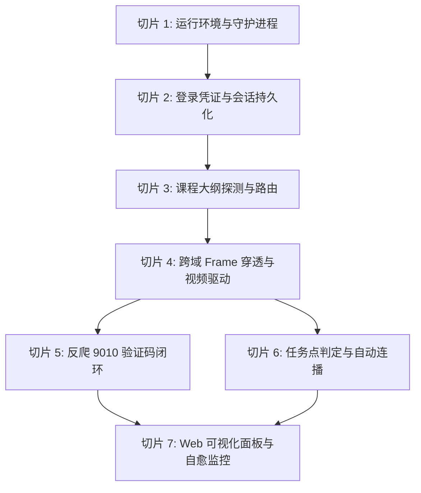

# 学习通 VPS 自动化后台挂机服务 —— 分步骤切片化实现方案

> **文档性质**：工程化落地指南与切片任务执行手册  
> **文档位置**：本地工程根目录 (`c:\Users\Atta\Desktop\学习通\`)  
> **实施原则**：采用垂直切片架构（Vertical Slicing），各切片具备清晰的前置依赖、受控代码范围与独立可验证的验收标准。全部文档严格保存在本地，严禁在 VPS 存储文档。

---

## 总体切片实施全景图



---

## 切片 1：基础设施与无头运行时环境切片 (Runtime & Daemon)

### 1.1 目标与范围
构建 VPS 基础无头运行环境与 Linux 系统级守护进程，解决中文字符集乱码及服务意外中断问题。

### 1.2 关键实施项
1. **依赖环境配置**：
   - Node.js LTS (>= 18.x)
   - Playwright Linux 运行依赖库：`npx playwright install-deps chromium`
   - Playwright Chromium 无头浏览器二进制安装：`npx playwright install chromium`
2. **Systemd 常驻守护配置**：
   - 服务文件：`/etc/systemd/system/xuexitong.service`
   - 配置项：
     - `WorkingDirectory=/root/workspace/xuexitongScript/vps-service`
     - `ExecStart=/usr/bin/node web.js`
     - `Restart=always`, `RestartSec=5`
     - `Environment=LANG=zh_CN.UTF-8`, `Environment=LC_ALL=zh_CN.UTF-8`
3. **编码规范固化**：
   - 所有 Node.js 读写文件（`fs.readFileSync`, `fs.writeFileSync`）显式传入 `'utf8'`。
   - 所有 HTTP API 响应头显式包含 `Content-Type: application/json; charset=utf-8`。

### 1.3 验收标准
- [x] 执行 `systemctl status xuexitong` 状态为 `active (running)`。
- [x] 重启机器或杀掉主进程后，`systemd` 能够在 5 秒内自动拉起服务。
- [x] `journalctl -u xuexitong` 查看中文日志无 `?` 或乱码。

---

## 切片 2：登录会话生命周期与扫码切片 (Auth & Session Persistence)

### 2.1 目标与范围
实现无需图形桌面的远程扫码认证，以及长期免重复扫码的 Cookie/Session 持久化机制。

### 2.2 关键实施项
1. **Persistent Context 隔离存储**：
   - 使用 `chromium.launchPersistentContext(userDataDir, { headless: true, ... })`，将浏览器核心 Profile 保存至 `vps-service/userData/`。
2. **二维码捕获与 Base64 流转**：
   - 导航至 `https://passport2.chaoxing.com/login?refer=https%3A%2F%2Fi.chaoxing.com%2Fbase`。
   - 等待 `#quickCode` 出现，对二维码节点独立截图保存为 `userData/qrcode.png`。
   - 将二进制转换封装为 Base64（`data:image/png;base64,...`），通过 EventEmitter 与 API 下发。
3. **状态跃迁异步监听器**：
   - 开启定时器轮询当前页面 URL。
   - 当 URL 脱离 `passport2.chaoxing.com/login` 即判定扫码成功，触发 `login_success` 事件。
4. **Cookie 导出与导入备份**：
   - 将 `context.cookies()` 序列化为 `userData/auth_state.json`。
   - 初始化时若存在该文件，执行 `context.addCookies()`，并访问 `https://i.chaoxing.com/base` 验证活跃度。

### 2.3 验收标准
- [x] 未登录状态下，调用 `POST /api/login` 能即时返回二维码 Base64 并在 Web 端渲染。
- [x] 学习通 App 扫码确认后，系统状态平滑转为 `LOGGED_IN`。
- [x] 重启 Node.js 进程，引擎能在不扫码的前提下识别已登录状态。

---

## 切片 3：课程大纲探测与小节路由切片 (Catalog Auto-Navigation)

### 3.1 目标与范围
允许用户直接粘贴课程大纲页（`studentcourse`）地址，系统自动向下穿透并定位到第一个未完成的任务点小节。

### 3.2 关键实施项
1. **地址类型匹配**：
   - 判断 URL 是否属于大纲模式（包含 `studentcourse`，或包含 `chaoxing.com` 但不含 `studentstudy`）。
2. **多 Frame 标记探测策略**：
   - 遍历 `[page, ...page.frames()]`。
   - 检索选择器：`.orange, span.orange, em.orange, .roundpoint, .catalog_point_round, .point_status, i.roundpoint, .jobCheckRound:not(.green)`。
3. **节点跳转与句柄同步**：
   - 通过 DOM 树逆向回溯 `closest('li, .posCatalog_item, tr')`，找到可点击链接锚点。
   - 调用 `link.scrollIntoView()` 与 `link.click()`。
   - 若学习通触发新窗口弹出（`target="_blank"`），监听 `context.on('page')` 自动把当前操作句柄切换至新标签页。

### 3.3 验收标准
- [x] 传入包含多个小节的大纲 URL，系统能精准命中首个未学完（黄色/橙色圆点）的小节。
- [x] 自动由 `studentcourse` 页面跳转并加载完成 `studentstudy` 播放页。

---

## 切片 4：嵌套多 Frame 视频播放驱动与防作弊 Hook 切片 (Playback Engine)

### 4.1 目标与范围
解决主页面失焦暂停、多层跨域 Iframe 无法操作、盲目点击导致误暂停、倍速失效及视频中途弹题等问题。

### 4.2 关键实施项
1. **防作弊反制 Hook 注入**：
   - 对全部活跃 Frame 注入原型属性覆盖：
     ```javascript
     Object.defineProperty(document, 'hidden', { value: false, writable: false });
     Object.defineProperty(document, 'visibilityState', { value: 'visible', writable: false });
     ['blur', 'mouseleave', 'mouseout', 'visibilitychange'].forEach(evt => {
         window.addEventListener(evt, e => e.stopImmediatePropagation(), true);
         document.addEventListener(evt, e => e.stopImmediatePropagation(), true);
     });
     ```
2. **Iframe 树遍历与目标帧锁定**：
   - 过滤 URL 匹配 `modules/video` 的内层 Frame（通常为 `mooc1-2.chaoxing.com/ananas/modules/video/index.html`）。
3. **幂等播放驱动实现**：
   - **禁止**在播放过程中触发 `.playBtn` 或视频画面点击。
   - 提取全局 `window.videojs` 实例：
     ```javascript
     if (v.paused && !v.ended) {
         v.muted = true;
         v.playbackRate = targetRate;
         if (vjs && typeof vjs.play === 'function') {
             vjs.muted(true);
             vjs.playbackRate(targetRate);
             vjs.play();
         } else {
             v.play().catch(() => {});
         }
     }
     ```
   - 维持倍速：若 `v.playbackRate !== targetRate`，主动刷新倍速。
4. **视频测验自动应答**：
   - 定位 `.ans-videoquiz-opt input`，自动勾选第一项并点击 `.ans-videoquiz-submit`。

### 4.3 验收标准
- [x] 即使无头浏览器无物理显示器，视频仍能持续以 1.5 倍速播放。
- [x] 视频播放进度（`currentTime`）稳定递增，每 12 秒日志输出一次进度。
- [x] 视频弹题出现时能在 3 秒内被自动作答并关闭，视频继续播放。

---

## 切片 5：反爬机制与【9010】验证码闭环切片 (Anti-Spider Handler)

### 5.1 目标与范围
当超星触发 `【9010】操作异常，请输入图片中的验证码` 时，系统不崩溃、不无限盲刷，并提供即时远程提单恢复机制。

### 5.2 关键实施项
1. **反爬拦截识别**：
   - 在定时监控循环中检测页面文本是否包含 `【9010】` 或 `请输入图片中的验证码`。
   - 若检测到，挂机状态标记为 `BLOCKED_CAPTCHA` 并记录告警日志。
2. **验证码图片提取**：
   - 监视器对验证码区域截图，并在 Web 管理面板显式弹窗提示。
3. **远程提单 API (`POST /api/captcha`)**：
   - 后端逻辑：
     ```javascript
     const input = await page.$('input[placeholder*="验证码"], #code, #checkCode');
     await input.fill(code);
     const submitBtn = await page.$('button, input[type="submit"], input[value="提交"]');
     await submitBtn.click();
     await page.waitForTimeout(3000);
     ```
4. **状态自愈与任务恢复**：
   - 提交后核验页面 URL 与 DOM 是否恢复正常。
   - 恢复正常后重新调起 `startMonitor()` 与播放驱动。

### 5.3 验收标准
- [x] 页面出现 9010 时，Web 运维面板弹出专属验证码输入框及图片预览。
- [x] 输入正确验证码提交后，系统自动通过校验并重回播放流程，无需重启服务。

---

## 切片 6：章节递进判定与自动连播切片 (Sequential Progression)

### 6.1 目标与范围
单视频完课后平滑跳转至下一节，形成课程全程自动推演闭环。

### 6.2 关键实施项
1. **完课达标判定**：
   - 条件：`v.ended === true` 或 `v.duration > 0 && v.currentTime >= v.duration * 0.96`。
2. **下一小节查找 Fallback 矩阵**：
   - **优先级 1**：当前激活项（`.posCatalog_select, .cur, .active`）的后续兄弟节点 `nextElementSibling`。
   - **优先级 2**：全局寻找其他带有 `.orange` 未完成圆点的小节链接。
   - **优先级 3**：点击播放器右侧栏的“下一任务点”控件（`#prevNextFocusNext, .nextChapter, #right1`）。
3. **切节后上下文重建**：
   - 点击后等待 4000ms，清理旧视频的监控状态，重新扫描新页面 Frame 树。

### 6.3 验收标准
- [x] 视频播放至 96% 以上时，控制台输出 `[视频完成]` 日志。
- [x] 系统自动触发跳转，目录小节高亮跃迁至下一小节，并开始载入新视频。

---

## 切片 7：Web 可视化面板与自愈监控切片 (Dashboard & Self-Healing)

### 7.1 目标与范围
提供直观、易用的 Web UI，集成实时画面监视、日志流查看、倍速调整及异常自愈。

### 7.2 关键实施项
1. **控制面板页面 (`public/index.html`)**：
   - 采用现代化深色/科技感仪表盘。
   - 模块包括：
     - **状态卡片**：当前状态、课程标题、播放进度、当前倍速。
     - **实时屏幕**：自动以每 2 秒刷新一次 `/api/screenshot`（防缓存时间戳）。
     - **控制区**：课程 URL 输入框、启动/停止按钮、下一节按钮、倍速下拉选框。
     - **反爬应急区**：动态显示的验证码输入框。
     - **运行日志流**：自动滚动的终端式日志容器。
2. **死锁监控与自愈心跳**：
   - 记录 `currentTime` 变动。
   - 若视频标记为 `playing: true` 但连续 90 秒 `currentTime` 毫无前进，自动触发一次 `v.play()` 重启或刷新当前 Frame。

### 7.3 验收标准
- [x] 浏览器打开 `http://<VPS_IP>:3888` 能够完整呈现控制面板。
- [x] 画面每 2 秒无闪烁自动刷新，实时映射无头浏览器的真实界面状态。
- [x] 所有按键操作（启动、暂停、跳节、倍速）均即时生效并反馈在日志中。

---

## 阶段验收与本地归档核查表

| 切片阶段 | 核心模块 | 本地源码/文件路径 | 验证手段 | 状态 |
| :--- | :--- | :--- | :--- | :--- |
| **Slice 1** | 守护环境 | `/etc/systemd/system/xuexitong.service` | `systemctl status xuexitong` | **已验证** |
| **Slice 2** | 登录管理 | `vps-service/engine.js` (`requestQrLogin`) | Web 面板呈现扫码 Base64 | **已验证** |
| **Slice 3** | 大纲导航 | `vps-service/engine.js` (`autoNavigateFromCatalog`) | 输入 `studentcourse` 地址自动进播放 | **已验证** |
| **Slice 4** | 播放引擎 | `vps-service/engine.js` (`driveVideoPlayback`) | Frame 6 抓取、幂等播放驱动、倍速维持 | **已验证** |
| **Slice 5** | 反爬应答 | `vps-service/web.js` + `engine.js` (`/api/captcha`) | 拦截 9010 页面、人工/接口提交验证码 | **已验证** |
| **Slice 6** | 自动切节 | `vps-service/engine.js` (`nextUnit`) | 96% 判定、查找下一节点并触发 click | **已验证** |
| **Slice 7** | 运维面板 | `vps-service/public/index.html` + `web.js` | 访问 3888 端口全功能仪表盘 | **已验证** |
