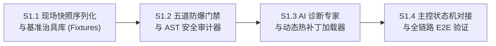

# 【XXT_TECH】切片 S1：自主沙箱热修复与自进化引擎实施规范

```
文档版本: v1.0.0
适用阶段: Implementation / Full-Lifecycle
归档分类: 03_技术方案_Architecture
核心模块: 切片 S1 自主沙箱热修复 / 五道防爆门禁 / AST安全审计 / 动态规则热替换
```

---

## 1. 切片背景与设计目标

### 1.1 痛点剖析
超星学习通平台在学期交替或系统版本迭代时，经常更新前端 DOM 结构：
1. 试题容器类名由 `.TiMu` 变异为混淆类名或动态 Hash；
2. 随堂测验阻断弹窗类名 `.ans-videoquiz` 发生变动；
3. 选项 `radio`/`checkbox` 容器层级嵌套加深；
4. 提交按钮绑定事件从 `onclick="btnBlueSubmit();"` 转向动态 JS 事件监听。

这些变动通常导致所有自动化工具抛出超时或匹配不到任何题目，陷入永久等待或跳过错题。人工介入需经过“用户报修 $\to$ 抓包排查 $\to$ 修改代码 $\to$ 重启服务”的漫长链条。

### 1.2 目标定位
切片 S1 实现**完全自治的代码级沙箱热修复闭环**：
- **故障零漏网**：发生提取异常时立即捕获事故现场（DOM Snapshot + 报错调用栈）；
- **AI 精准定位**：LLM 专家分析 DOM 差异，生成结构化规则补丁；
- **五道防爆门禁（The 5 Defense Gates）**：确保补丁在独立沙盒内通过 AST 爆炸半径白名单审查、语法校验、100% 历史回归测试，具备毫秒级自动回滚能力；
- **内存无感热生效**：无需重启挂机主进程与浏览器上下文，新规则即刻注入生效。

---

## 2. 细分切片实施路线 (Sub-Slice Roadmap)



| 子切片编号 | 模块职责 | 交付产物 | 验收断言 |
| :--- | :--- | :--- | :--- |
| **S1.1** | 现场快照序列化与基准测试治具库 | `incidentDumper.js`, `testFixtures.js` | 能够在提取失败时生成标准事故包；提供 5 套典型已知题型 DOM 基准。 |
| **S1.2** | 五道防爆安全门禁与 AST 审查器 | `astAuditor.js`, `gatekeeper.js` | 能够严格拦截危险语法（`child_process`、`eval` 等），只允许修改规则白名单；通过 `node --check` 语法与 Mock 回归校验。 |
| **S1.3** | AI 代码诊断专家与动态热补丁加载器 | `aiRepairExpert.js`, `ruleManager.js` | 能够结合故障 DOM 生成补丁；在不重启进程的前提下热重载选择器规则。 |
| **S1.4** | 核心状态机集成与全链路自进化测试 | `examSolver.js` 对接, `test_s1_e2e.js` | 模拟“平台 DOM 突变”，系统自动触发诊断、过五关门禁、热修生效，并成功完成测验提取。 |

---

## 3. 五道防爆门禁架构规范 (The 5 Defense Gates)

```
[故障触发] -> Incident Dump (HTML + Trace)
                  │
                  ▼
         [AI Repair Expert] (合成候选补丁)
                  │
  ┌───────────────┴────────────────────────────────┐
  │              五道防爆安全门禁体系                │
  │                                                │
  │  Gate 1: 隔离沙盒 (Sandbox Worktree / Temp Dir) │
  │  Gate 2: 爆炸半径与 AST 白名单控制               │
  │  Gate 3: 静态语法健康校验 (node --check)        │
  │  Gate 4: 离线 Mock 治具全量回归 (100% Pass)     │
  │  Gate 5: 毫秒级熔断看门狗与自动回滚             │
  └───────────────┬────────────────────────────────┘
                  │ 5 关全胜
                  ▼
        [Dynamic Rule Loader] -> 实时内存替换生效
```

### 3.1 Gate 1: 隔离沙盒 (Sandbox Isolation)
所有补丁的生成、写入与初审严禁在主工程目录或生产文件直接进行。
- 补丁临时写入 `.sandbox/hotfix-<timestamp>/` 独立目录；
- 在沙盒内执行编译测试，杜绝文件锁冲突与未经验证的代码污染。

### 3.2 Gate 2: 爆炸半径与 AST 白名单控制 (Blast Radius & AST Whitelist)
- **文件范围白名单**：AI 补丁只允许产出针对 `vps-service/rules/selectors.json` 的规则增量字典，禁止直接输出可执行的任意 JS 代码；
- **AST/语法审计**：若输出包含代码块，必须经 `astAuditor.js` 检查：
  - 严禁包含：`require('child_process')`, `process.exit`, `eval`, `Function`, `fs.rmdir`, `fs.unlink`；
  - 严禁包含任何外部网络外呼（如 `fetch`, `axios`, `http.request`）除受控 LLM 客户端之外的调用。

### 3.3 Gate 3: 静态语法健康校验 (Static Syntax Gate)
沙盒中的规则解析或代码在装载前，必须通过 `node --check` 校验，确保 $0\text{ Error}$ 且符合 JSON/ES 规范。

### 3.4 Gate 4: 离线 Mock 治具全量回归 (Offline Mock Regression Gate)
测试套件内包含 5 套不同历史学期的真实试卷 DOM 结构。
- 候选补丁必须保证：**过往 5 套历史试卷提取准确率保持 100%**；
- 候选补丁在**引发故障的当前 DOM 快照中，提取成功率从 0% 提升至 100%**。
- 任一历史基线用例失败，即刻否决并回退。

### 3.5 Gate 5: 毫秒级熔断器与原子回滚 (Circuit Breaker & Rollback)
- 热补丁由内存中的 `RuleManager` 统一代理分发，支持版本打标（如 `v1.0.1-patch-20261014`）；
- 若新补丁注入后，连续 2 次同一课程小节再次抛出异常，触发熔断器：
  - 在 $<100\text{ms}$ 内撤销内存补丁，恢复上一个稳定版本；
  - 标记该故障类型为“需人工介入”，防止死循环调用 LLM 浪费配额。

---

## 4. 接口与数据结构契约

### 4.1 事故现场快照包结构 (`IncidentDump`)
```json
{
  "incidentId": "INC_1791956000000_123",
  "timestamp": 1791956000000,
  "taskId": "task_1",
  "taskName": "中国历史与传统文化",
  "scene": "CHAPTER_EXAM",
  "error": "ExamExtractionFailed: Container detected but 0 valid questions parsed.",
  "frameUrl": "https://mooc1-2.chaoxing.com/work/doHomeWorkNew",
  "htmlSnapshot": "<div class=\"new_TiMu\">...</div>",
  "currentSelectors": {
    "container": ".TiMu, .Zy_TItle, #submitForm",
    "questionNode": ".TiMu, .singleQuesId, .marBom60",
    "options": "li, .Zy_ulTop li, .answerBg, label"
  }
}
```

### 4.2 规则补丁契约 (`RulePatch`)
```json
{
  "version": "1.0.1-patch-1791956000000",
  "target": "examSelectors",
  "patchType": "MERGE_SELECTORS",
  "selectors": {
    "container": ".TiMu, .Zy_TItle, #submitForm, .new_TiMu",
    "questionNode": ".TiMu, .singleQuesId, .marBom60, .new_singleQuesId",
    "stem": ".Zy_TItle_name, .Zy_TItle, .fontx, h3, .stem, .new_stem",
    "options": "li, .Zy_ulTop li, .answerBg, label, .new_option_item"
  },
  "rationale": "超星在 2026 题型模板中新增了 .new_TiMu 与 .new_singleQuesId 容器命名"
}
```

---

## 5. 验收标准与交付物清单
1. 源码：`vps-service/selfHeal/` 完整自愈套件。
2. 规则集：`vps-service/rules/selectors.json` 解耦自愈规则库。
3. 治具：`vps-service/selfHeal/testFixtures.js` 包含 5 套真实/变异 HTML 治具。
4. 测试：`05_测试与验收_QA/cases/XXT_TEST_切片S1_自愈沙箱五道门禁全量回归_v1.0.0.js` 自动化测试脚本，断言 100% 通过。
