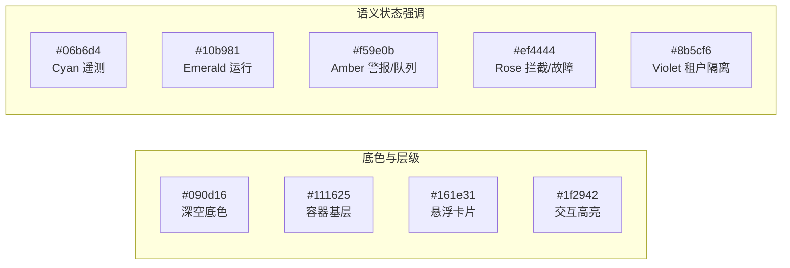
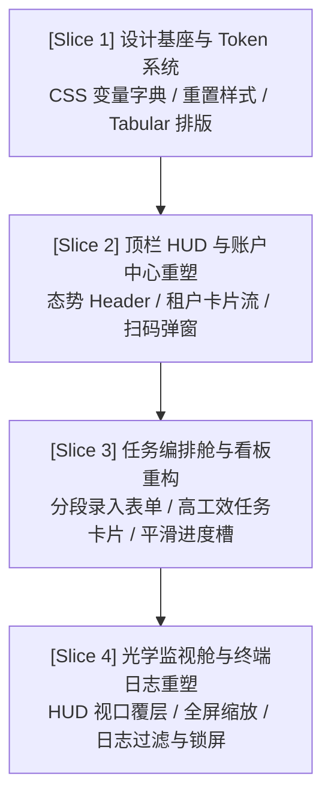

# XXT - 学习通多租户智能并发挂机工作台 —— 视觉美学与工效重构技术方案 (TECH-006)

> **文档性质**：架构设计 RFC & 前端视觉美学与工效重塑技术方案  
> **文档标识**：`XXT_TECH_多租户工作台视觉美学与工效重构方案_v1.0.0.md`  
> **遵循规范**：`fullcycle-dev-practice` / `frontend-design` / `theme-factory` / `XXT_STD_全流程工程研发与交付运维治理规范_v1.0.0.md`  
> **适用版本**：XXT-VPS Service v1.2+  
> **生效范围**：`vps-service/public/index.html` 及全平台监控控制台 UI

---

## 1. 现状审计与重构动因 (Audit & Critique)

### 1.1 业务与系统现状
学习通多租户智能并发挂机服务（XXT-VPS Automation Engine）现已完成多账号独立隔离（BrowserContext 容器化）、多任务并发调度线程池、大模型随堂测验自动答题与 9010 反爬图片验证码人工/自动中继闭环。

当前工作台的前端页面（`vps-service/public/index.html`，4.6 万字节单文件 SPA）负责呈现整个后台服务的运行状态、账户池、任务队列、实时渲染推流及日志流。虽然基础交互逻辑完备，但在视觉表现与操作工效上存在典型的**“AI 原型化/简陋暗黑套皮”**缺陷。

### 1.2 现存设计 Anti-Patterns 深度审计（依据 `frontend-design` 规范）

| 缺陷维度 | 现状表现 (Symptom) | 根因与体验损耗 (Root Cause & Impact) |
| :--- | :--- | :--- |
| **视觉基底平庸化** | 采用单一的 `#0b1120` 深蓝底色与硬生生的 `#151f32` 卡片块，无层次微质感 | 缺乏空间纵深与光影通透感，长时间盯屏易产生视觉疲劳，呈现廉价的模板套壳感。 |
| **色彩与对比失序** | 高频使用单一的饱和天蓝 `#38bdf8` 与粗暴的青绿 `#22c55e`，缺少语义权重分层 | 重点信息（如卡死报错、验证码拦截）与次要信息（如课程别名、网速标签）争夺眼球，缺乏克制。 |
| **Emoji 泛滥代偿** | 大量充斥 `⚡`、`👥`、`➕`、`📋`、`🖥️`、`📜`、`👤`、`▶`、`⏸`、`🔑`、`🗑` 等系统 Emoji | 典型业余脚本工具特征；跨操作系统（Windows/Linux/macOS/iOS）Emoji 渲染风格极度割裂。 |
| **数字抖动与排版杂乱** | 进度百分比、视频时长、时间戳使用常规变宽无衬线字体，在 1 秒轮询刷新时文字水平抖动 | 破坏操作专注感；缺少标准等宽数字排版（`font-variant-numeric: tabular-nums`）。 |
| **监视器缺少工效仪表感** | 实时画面视口为一个普通的黑底 `` 标签，仅有一行半透明角标 | 无法直观感知无头浏览器真实分辨率、帧刷新状态、网络延迟与当前捕获节点。 |
| **日志终端工效低下** | 简单的只读 `<div class="log-box">`，缺少日志分级高亮过滤、搜索及滚屏锁 | 任务并发量大时日志快速刷屏，关键 AI 答题与反爬告警转瞬即逝，无法冻结定位排查。 |
| **卡片交互层级坍塌** | 任务卡片内部包含多处嵌套点击（整卡选择 vs 按钮操作），容易误触卡片选中状态 | 按钮边框细小扁平，无明确的悬浮微动效与按下触感。 |

---

## 2. 美学定位与设计语言 (Aesthetic Direction & Design Language)

### 2.1 主题定位：赛博工效指挥中心 (Tactical Mission Control)
根据 `frontend-design` 规范，UI 设计必须深深扎根于产品的业务本质。学习通自动化挂机工作台不是一个大众消费类 App，而是一个**面向极客与自动化运维者的“多线程远程无人值守作战指挥室”**。

视觉核心理念确立为：**“沉稳克制、深邃透光、严谨等宽、军工级态势感知”**。

```
┌────────────────────────────────────────────────────────────────────────┐
│                   XXT TACTICAL MISSION CONTROL SYSTEM                  │
├────────────────────────────────┬───────────────────────────────────────┤
│ 💎 极致克制: 剔除杂乱 Emoji,   │ 🔭 深度纵深: 采用 Obsidian 渐变黑曜石  │
│    采用矢量精工 SVG 语义微图标 │    微边框光效与 Glassmorphism 磨砂质感 │
├────────────────────────────────┼───────────────────────────────────────┤
│ ⏱ 等宽稳固: 时间、百分比、    │ 🎯 焦点聚焦: 画面视口 CRT 扫描线与     │
│    节点数全面采用 Tabular 规范 │    微脉冲态势感知指示灯               │
└────────────────────────────────┴───────────────────────────────────────┘
```

### 2.2 核心配色系统 (Obsidian Matrix Palette)

本方案选定自研的 **Obsidian Matrix（黑曜矩阵）** 高级工程主题，兼顾长时间夜间观察舒适度与高对比警示性：



| Token 变量名 | 色值 (HEX / RGBA) | 语义与应用场景 |
| :--- | :--- | :--- |
| `--xxt-bg-core` | `#090d16` | 全局视口最底层深空黑曜石底色 |
| `--xxt-surface-1` | `#111625` | 主控制台容器、顶栏 HUD、分栏面板基础背景 |
| `--xxt-surface-2` | `#161e31` | 账户卡片、任务卡片、表单输入框底色 |
| `--xxt-surface-3` | `#1e2942` | 卡片悬停态、选中高亮背景、下拉菜单展开态 |
| `--xxt-border-subtle` | `rgba(255, 255, 255, 0.07)` | 常规容器边框、极细隔离线（1px） |
| `--xxt-border-glow` | `rgba(6, 182, 212, 0.35)` | 选中态卡片、运行中任务的微发光边框 |
| `--xxt-text-primary` | `#f8fafc` | 核心标题、关键读数、高亮状态文字 |
| `--xxt-text-secondary`| `#94a3b8` | 标签说明、参数键名、次级辅助描述 |
| `--xxt-text-muted` | `#64748b` | 禁态文字、版权标记、占位提示符 |
| `--xxt-signal-cyan` | `#06b6d4` | 遥测信标、多租户容器标识、主操作 CTA |
| `--xxt-signal-emerald`| `#10b981` | 任务运行中（RUNNING）、网络畅通心跳点 |
| `--xxt-signal-amber` | `#f59e0b` | 排队中（QUEUED）、验证码待解、频次预警 |
| `--xxt-signal-rose` | `#f43f5e` | 异常中断（ERROR）、会话失效、强行终止 |
| `--xxt-signal-violet` | `#8b5cf6` | 租户隔离空间（Tenant Context）、AI 解题徽章 |

### 2.3 字体与排版标准 (Typography Architecture)

1. **界面字体家族 (UI Font Stack)**：
   ```css
   font-family: -apple-system, BlinkMacSystemFont, "Segoe UI", "PingFang SC", "Hiragino Sans GB", "Microsoft YaHei", "Noto Sans SC", sans-serif;
   ```
2. **遥测与数据字体家族 (Telemetry & Monospace Stack)**：
   ```css
   font-family: "JetBrains Mono", "Cascadia Code", "SF Mono", Menlo, Monaco, Consolas, "Courier New", monospace;
   font-variant-numeric: tabular-nums lining-nums;
   ```
3. **字阶比例规约**：
   - 顶栏主标：`1.15rem` (`18px`), `font-weight: 600`, `letter-spacing: -0.01em`
   - 区块标题：`0.92rem` (`14.7px`), `font-weight: 600`, 大小写规整
   - 正文与表单：`0.84rem` (`13.5px`), `line-height: 1.5`
   - 辅助徽章与时序：`0.72rem` (`11.5px`), `font-weight: 500`

---

## 3. 工作台各模块重构设计方案 (Component Engineering Spec)

### 3.1 总体组件拓扑 (Component Hierarchy)

```
┌────────────────────────────────────────────────────────────────────────┐
│ [Component 1] 顶栏态势感知 HUD (Master Telemetry Bar)                  │
│  - 系统品牌徽章   - VPS 节点与出口 IP 胶囊   - 隔离引擎态   - 全局状态心跳 │
├────────────────────────────────────────────────────────────────────────┤
│ [Component 2] 多租户账户网格中心 (Tenant Context Deck)                 │
│  - 账户身份头像/徽章   - 会话保活健康度   - 关联任务量   - 快捷扫码抽屉 │
├────────────────────────────────────────────────────────────────────────┤
│ [Component 3] 全局调度与并发控制总线 (Scheduler Matrix Bar)            │
│  - 最大并发步进选择器   - 运行/排队/完成状态仪表   - 一键全启动/全暂停 │
├──────────────────────────────────┬─────────────────────────────────────┤
│ [Component 4] 任务编排与看板     │ [Component 5] 实时光学监视与遥测终端 │
│ (Task Orchestrator & Kanban)     │ (Optical HUD & Terminal Stream)     │
│  4.1 智能录入舱 (单课/批量)       │  5.1 光学视口 (CRT 微滤镜/态势覆层)  │
│  4.2 账户筛选器与优先级队列       │  5.2 状态时序水映/全屏缩放          │
│  4.3 高工效任务卡片 (进度微光)    │  5.3 结构化日志控制台 (分级/搜索/锁)│
└──────────────────────────────────┴─────────────────────────────────────┘
```

### 3.2 模块一：顶栏态势感知 HUD (Master Telemetry Bar)
- **剔除粗糙感**：去除 `⚡`、硬编码粗边框。
- **重构为航天级控制台 Header**：
  - 左侧：内嵌高精度 SVG 脉冲标志 + “XXT // 智能并发挂机工作台” 标志；
  - 中间：网络出口遥测胶囊，带动态 Ping 延迟微绿点（呼吸灯动效 `@keyframes pulse-glow`）；
  - 右侧：租户容器隔离引擎就绪状态指示、全局任务调度状态芯片（IDLE / RUNNING / BUSY）。

### 3.3 模块二：多租户账户网格中心 (Tenant Context Deck)
- **重构前**：每个卡片样式单调，容易溢出，登录状态与未登录状态对比微弱。
- **重构后**：
  - **首字母/身份微徽章 (Avatar Glyph)**：依据账户别名自动生成优雅圆角渐变字母头像；
  - **状态光环 (Status Aura Ring)**：
    - 已登录：左侧 3px 祖母绿状态坚线 + 浅微光背景，显示学生真实姓名及院校；
    - 待登录：浅琥珀色微虚线边框，高亮行动呼吁 “扫码授权”；
  - **信息工效提升**：清晰呈现该账户绑定的任务负荷（如 “3 门进行中”）；
  - **操作按钮组**：右对齐微质感胶囊按钮，删除操作加二次确认安全防护。

### 3.4 模块三：任务编排与看板 (Task Orchestrator & Kanban)
- **4.1 智能录入舱**：
  - 切换按钮由老旧下划线 Tabs 改为现代**分段药丸切换器 (Segmented Pill Switcher)**；
  - 单课录入与批量录入支持自动正则识别 URL 中的 `courseId` 与 `clazzid`，给出识别合规微角标；
  - 倍速选择器改造为集成式分段微控。
- **4.2 高工效任务卡片 (Tactical Kanban Card)**：
  - **层级分明**：卡片顶栏为课程名 + 归属账户芯片（带租户紫底）+ 倍速微标；
  - **当前小节走马灯**：截断溢出优化，显示清晰的章节节点与播放状态；
  - **平滑双色进度条**：
    - 采用渐变能量槽设计（`linear-gradient(90deg, #06b6d4, #10b981)`）；
    - 百分比与秒数时序严格采用等宽字体（`JetBrains Mono`），轮询刷新坚决不闪烁；
  - **动作按钮工效**：按钮采用独立防冒泡容器，悬浮具备微按压反馈（`transform: translateY(-1px)`）。

### 3.5 模块四：实时光学监视与遥测控制台 (Optical HUD & Terminal Stream)
- **5.1 实时画面视口 (Live Headless Optical Viewport)**：
  - 采用 **16:9 仪表舱外壳**，支持画面自适应居中与防模糊采样；
  - 引入极其克制的**微微 CRT 扫描线与暗角质感 (Subtle CRT Scanline)**，渲染极客视效；
  - **HUD 态势浮层**：
    - 顶部/底部半透明玻璃覆盖条：实时标注当前正在截取的任务 ID、当前小节、更新时间戳；
    - 右上角提供 **“🔍 全屏查看快照”** 与 **“🔄 立即截屏”** 按钮。
- **5.2 结构化日志控制台 (Terminal Stream Console)**：
  - 彻底淘汰简陋的纯文本列表；
  - **控制台顶栏**：
    - 日志源筛选（全部 / 当前选中任务）；
    - **日志级别分段过滤**：全部 / 正常 / 警告 / 报错 / AI 答题；
    - **滚屏锁（Auto-scroll Lock）**：点击可暂停自动滚动，便于排查长报错；
    - **一键清屏** 按钮；
  - **语法着色与规整对齐**：
    - 时间戳（Muted Slate）、任务标识（Tenant Cyan）、模块（Engine Violet）、消息主体规范分列。

### 3.6 模块五：交互模态框与轻量通知 (Glassmorphism Modals & Toasts)
- **磨砂玻璃遮罩**：`backdrop-filter: blur(8px)` + `rgba(9, 13, 22, 0.75)`；
- **扫码模态框重构**：
  - 超星二维码图片包裹高质感圆角白框，居中微投影；
  - 动态状态侦测圆环（扫码就绪 -> 正在扫码 -> 认证成功）；
- **轻量吐司通知 (Toast Notification)**：
  - 代替原始的浏览器原生 `alert()`，支持右上角优雅浮出并自动退场。

---

## 4. 切片化实施路线图 (Vertical Slice-Driven Roadmap)

遵循 `fullcycle-dev-practice` 规范的纵向切片隔离原则，整个工作台美学重构严禁“一次性盲目全盘覆写”，划分为 4 个清晰可测试的研发切片：



### 切片 1：设计基座与 Token 系统构建 (Design Tokens & Typographic Reset)
- **交付内容**：
  - 定义完整的 Obsidian Matrix CSS 变量体系（颜色、曲率、边框微光、过渡曲线）；
  - 引入等宽数字排版规约与自适应响应式基础网格布局；
  - 重构所有基础元素：按钮系统（`.btn-primary`, `.btn-secondary`, `.btn-danger`, `.btn-ghost`）、输入控件（Input, Select, Textarea）；
- **验证准则**：基础排版规范就绪，无样式冲突，按钮与表单控件交互反馈舒适。

### 切片 2：顶栏 HUD 与多租户协同 Deck 深度重构 (Header HUD & Account Deck)
- **交付内容**：
  - 重写 Header HTML/CSS，实现态势感知 IP 胶囊与脉冲呼吸灯；
  - 改造多账户卡片列表渲染逻辑，引入首字母微徽章与左侧状态坚线；
  - 升级扫码登录与新增账户弹窗为 Glassmorphism 磨砂质感；
- **验证准则**：多账户显示清晰分明，未登录与已登录状态一眼即辨，扫码弹窗唤起流畅。

### 切片 3：任务编排舱与看板交互重塑 (Task Orchestrator & Kanban)
- **交付内容**：
  - 重写任务创建区为分段药丸切换器，精简 URL 录入与倍速设置表单；
  - 彻底美化任务看板卡片，实现状态光边、小节走马灯、等宽平滑进度条；
  - 强化按钮点击防穿透（`event.stopPropagation()`），避免触发展开选中状态错乱；
- **验证准则**：任务列表数据密集度适中，进度变化无文字水平晃动，任务启停/置顶/删除响应灵敏。

### 切片 4：光学视口与结构化终端日志重塑 (Live Optical HUD & Terminal Stream)
- **交付内容**：
  - 升级画面监控容器为 16:9 仪表舱视口，增加 HUD 态势角标与全屏放大模态框；
  - 重写日志控制台渲染体系，集成日志过滤选择器、清屏、滚屏锁定功能与语法色彩分流；
  - 替换旧式 `alert()` 为优雅的 Toast 浮动通知组件；
- **验证准则**：实时画面推流与日志刷新顺畅，长日志流可自由暂停查验，无内存泄漏与 DOM 卡顿。

---

## 5. 接口契约与数据流零回归保障 (Contract & Invariants)

为了确保本次前端美学重构与现有的后台 Node.js 服务（`web.js`、`taskManager.js`、`accountManager.js`）**100% 零暗账兼容、零回归**，明确以下关键契约铁律：

### 5.1 DOM ID 契约表 (DOM Element Invariants)
重构过程中，凡涉及客户端 JavaScript 获取并操作的 DOM ID 必须严格保留或无缝对齐：

| 现有 DOM ID | 业务职责 | 重构保留状态 | 兼容性保证 |
| :--- | :--- | :--- | :--- |
| `globalStatusBadge` | 顶栏全局状态徽章 | **保留并美化** | 接收 `data.status` 动态赋予 `.status-*` |
| `concurrencySelect` | 全局最大并发下拉框 | **保留并美化** | 触发 `changeConcurrency(val)` API |
| `statRunning` / `statQueued` / `statTotal` | 统计数字面板 | **保留并美化** | 维持轮询文本注入 |
| `accountCardsView` | 多账户卡片注入容器 | **保留** | 适配新版卡片模板渲染 |
| `singleCreateForm` / `batchCreateForm` | 表单显隐容器 | **保留** | 药丸切换器联动 |
| `singleUrl` / `singleName` / `singleRate` | 单任务输入框 | **保留** | 维持表单取值 |
| `batchUrls` / `batchRate` | 批量任务输入框 | **保留** | 维持换行解析逻辑 |
| `taskAccountFilter` | 任务账户筛选下拉框 | **保留** | 触发 `renderTaskList()` |
| `taskListView` | 任务列表注入容器 | **保留** | 适配新版高工效卡片模板 |
| `livePreviewImg` | 实时画面图片元素 | **保留** | 动态追加时间戳防缓存刷图 |
| `logBoxView` | 日志输出容器 | **保留** | 支持结构化富文本与筛选切片 |
| `createAccountModal` / `accountQrModal` | 模态框容器 | **保留** | 样式提升为磨砂玻璃浮层 |

### 5.2 API 交互零变更
- 前端请求的 `/api/tasks`、`/api/accounts`、`/api/qrcode.png`、`/api/screen.png`、`/api/concurrency`、`/api/tasks/start-all` 等全部 REST 接口入参及出参结构**严格保持原样**，无需改动服务端一行动行逻辑。

---

## 6. 质量验收与验证方案 (QA & Acceptance Criteria)

### 6.1 视觉与响应式验收项
1. **多分辨率适配**：
   - 桌面极客大屏（1920 × 1080 / 1440 × 900）：双栏平铺通透，信息密度合理，无横向滚动条；
   - 便携笔记本（1280 × 800）：自适应收缩，保持双栏最小宽度；
   - 平板/手机端（≤ 1024px）：自动平滑降级为单栏垂直堆叠流。
2. **长时间挂机抗疲劳**：深空黑曜石底色与柔和边框光效，确保连续观察 2 小时以上无刺眼感。
3. **数字稳定性**：进度数值与时序刷新时，无横向像素抖动（Tabular Numbers 校验）。

### 6.2 交互与工效验收项
1. **多账号扫码流**：新建账户 -> 打开扫码弹窗 -> 二维码清晰居中 -> 扫码成功自动关闭，全流程丝滑顺畅。
2. **任务批量录入**：粘贴多门课程 URL，一键解析注入队列，列表即时呈现。
3. **日志排障工效**：高并发日志刷屏时，开启“滚屏锁定”，日志停止自动向下滚，可正常选中复制错误信息；切换“仅报错”过滤项，非警告日志瞬间隐藏。
4. **实时画面推流**：无头浏览器截屏每 1~2 秒平稳刷新，HUD 浮层清晰呈现对应任务及时间戳。

---

## 7. 结语与后续推进

本方案从根本上颠覆现有的粗放暗色模板，以“战术工效指挥中心”为基调，融合 `frontend-design` 的审美准则与 `fullcycle-dev-practice` 的工程闭环标准。

完成本技术方案审定后，即可全面转入**切片 1 至切片 4** 的代码手术式实施与自动化回归验收。
