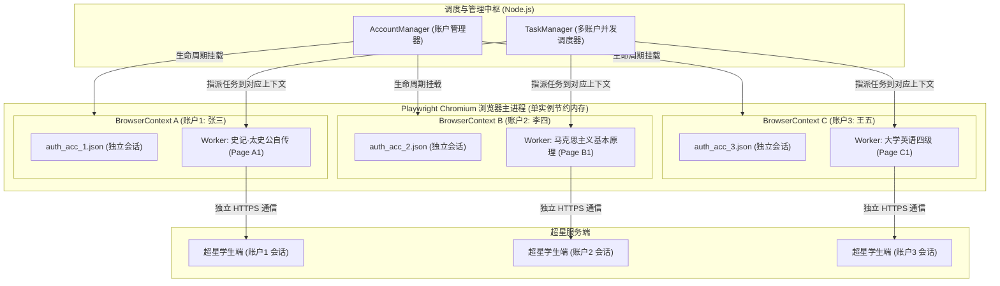
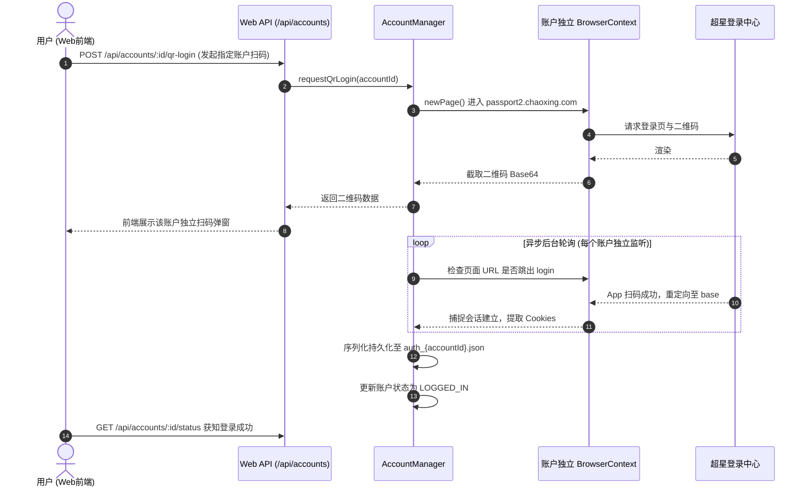

# 学习通多账户并发挂机架构设计与实施规范

> **文档版本**：v1.0.0 (Multi-Account Isolated Concurrency Specification)  
> **制定日期**：2026-10-14  
> **项目名称**：学习通自动化挂机服务 (`vps-service`)  
> **目标模块**：多租户账户管理中心、独立上下文隔离调度器、前端多账户工作台  
> **存储位置**：`c:\Users\Atta\Desktop\学习通\学习通多账户并发挂机架构设计与实施规范.md`

---

## 1. 业务背景与架构动机 (Background & Motivation)

### 1.1 需求定位升级
在前期版本中，系统的并发设计局限于“**单账号名下多门课程**”的并发挂机。而在实际多用户协同、代挂托管或多个人号同步修读等生产场景中，用户的真正核心诉求是：
> **“支持同时给不同超星账户刷课，且各账户之间互不干扰、独立认证、独立并发、防止串号。”**

### 1.2 关键技术挑战
1. **Cookie 与会话污染**：Playwright 默认的单个 `BrowserContext` 在所有 `Page` 之间共享 Cookie。若直接在同一上下文中打开不同账户的课程，会产生严重会话覆盖、踢出甚至作弊风控。
2. **多账户独立认证生命周期**：每个账户需要独立的登录二维码生成、独立的 App 扫码监听、独立的 Session Cookie 持久化（如 37 个认证 Cookie）以及过期重新登录机制。
3. **任务-账户绑定与调度解耦**：调度引擎需要能够识别每个任务属于哪个账户，并为其分配挂载在对应账户上下文下的 Worker 实例。

---

## 2. 总体架构设计 (Architecture Design)

### 2.1 物理级上下文隔离模型 (Multi-Context Container Model)

系统采用 **单 Chromium 实例 + 多独立 BrowserContext 容器化隔离** 架构：



- **隔离性**：每个 `BrowserContext` 拥有完全隔离的 Cookie Jar、Local Storage、Session Storage 与 Cache，超星服务端识别为来自不同独立会话；
- **资源利用率**：共享底层 Chromium 进程与 GPU 渲染管道，避免同时启动多个 Chromium 进程带来的数百兆额外基础内存开销。

---

## 3. 数据模型设计 (Data Models)

### 3.1 账户实体定义 (`AccountProfile`)
数据存储于 `vps-service/data/accounts.json`：
```typescript
interface AccountProfile {
    id: string;               // 唯一标识，如 "acc_1728889901"
    name: string;             // 账户备注名（如 "张三 (主号)"）
    status: 'NEED_LOGIN' | 'LOGGED_IN' | 'EXPIRED' | 'LOGGING_IN'; // 登录状态
    cookieFile: string;       // 持久化 Cookie 路径，如 "auth_acc_1.json"
    lastLoginAt: number;      // 最近一次登录成功时间戳
    createdAt: number;        // 创建时间
    userRealName?: string;    // 从超星页面抓取的真实姓名 (如 "张三")
    schoolName?: string;      // 绑定的学校/单位 (如 "华南理工大学")
}
```

### 3.2 任务实体升级 (`Task` 拓展)
在原有任务结构中新增 `accountId` 强绑定：
```typescript
interface Task {
    id: string;               // 任务 ID，如 "task_1"
    accountId: string;        // 绑定的超星账户 ID (关联 AccountProfile.id)
    name: string;             // 课程名称
    url: string;              // 课程 URL
    status: 'QUEUED' | 'RUNNING' | 'PAUSED' | 'COMPLETED' | 'ERROR';
    playbackRate: number;     // 独立倍速
    progress: {
        unitTitle: string;
        percentage: number;
        currentTime: number;
        duration: number;
    };
    createdAt: number;
    updatedAt: number;
}
```

---

## 4. 核心调度与认证流程 (Core Workflows)

### 4.1 独立扫码认证时序 (Decoupled QR Login)


### 4.2 跨账户并发任务调度流程 (Cross-Account Scheduling)
1. **就绪队列提取**：调度器检测当前运行中的 Worker 数是否小于 `maxConcurrent`；
2. **提取首个就绪任务**：从 `QUEUED` 列表中选出优先级最高任务 $T$；
3. **账户上下文解析**：根据 $T.accountId$ 从 `AccountManager` 获取其专属 `BrowserContext`；
   - 若该账户尚未登录（`status !== 'LOGGED_IN'`），任务标记为等待登录或挂起，并通知前端；
   - 若上下文已就绪，调用 `context.newPage()`；
4. **启动独立 Worker**：将该页面注入专属 `TaskWorker` 实例并分配槽位运行；
5. **多路监控与日志分发**：不同账户的任务日志携带各自的 `taskId` 与 `accountId` 标签，前端可按账户或任务分别筛选。

---

## 5. RESTful API 接口规范 (API Specification)

| 方法 | 路径 | 功能说明 | 核心入参 / 返回值 |
| :--- | :--- | :--- | :--- |
| `GET` | `/api/accounts` | 获取所有超星账户列表及登录状态 | 返回 `AccountProfile[]` 数组 |
| `POST` | `/api/accounts` | 创建新账户档案 | `{ name: "李四" }` $\to$ 返回新 `account` |
| `POST` | `/api/accounts/:id/qr-login` | 请求指定账户的扫码登录二维码 | 返回 `{ qrBase64: "data:image/..." }` |
| `GET` | `/api/accounts/:id/status` | 查询指定账户当前登录态 | 返回 `{ status: "LOGGED_IN", realName: "..." }` |
| `DELETE` | `/api/accounts/:id` | 删除账户并清理关联 Cookie | 返回 `{ success: true }` |
| `POST` | `/api/tasks` | 创建任务（升级支持绑定账户） | `{ accountId: "acc_1", url: "https://...", name: "..." }` |
| `GET` | `/api/tasks` | 获取任务列表（返回包含 `accountName`） | 返回增强型任务数组 |

---

## 6. 前端工作台交互升级规格 (Frontend UI Specification)

前端面板将在顶部与任务管理区增设多账户控制层：

```
┌────────────────────────────────────────────────────────────────────────┐
│  ⚡ 学习通 多账户独立并发挂机控制台   [全局并发 Worker: 2/3] [账户数: 2] │
├────────────────────────────────────────────────────────────────────────┤
│ 【超星账户管理栏】                                                     │
│ ┌──────────────────────┐ ┌──────────────────────┐ ┌──────────────────┐ │
│ │ 👤 账户 #1: 张三      │ │ 👤 账户 #2: 李四      │ │ ➕ 添加新账户     │ │
│ │ 状态: [🟢 登录有效]   │ │ 状态: [🟡 需扫码登录] │ │ (独立多账号管理) │ │
│ │ 运行中任务: 1 门课   │ │ [点击扫码登录]       │ │                  │ │
│ └──────────────────────┘ └──────────────────────┘ └──────────────────┘ │
├────────────────────────────────────────────────────────────────────────┤
│ 【新建刷课任务】                                                       │
│  选择归属账户: [ 👤 张三 (有效) ▾ ]                                    │
│  课程 URL:    [ https://mooc1-2.chaoxing.com/... ]                     │
│  课程倍速:    [ 1.0x ▾ ]   [＋ 加入并发队列]                           │
├───────────────────────────────────┬────────────────────────────────────┤
│ 【任务看板 (按账户区分)】         │ 【实时画面监控与分任务日志】       │
│  [全部(3)] [张三(2)] [李四(1)]    │  监视视口: [ 张三-史记 ] [ 李四-毛概]│
│ ┌───────────────────────────────┐ │ ┌────────────────────────────────┐ │
│ │ [张三] 史记·太史公自传        │ │ │                                │ │
│ │ 状态: [挂机中] 进度: 92%      │ │ │   [实时截图: 张三-史记]        │ │
│ ├───────────────────────────────┤ │ └────────────────────────────────┘ │
│ │ [李四] 马克思主义基本原理     │ │ [02:30] [张三] 播放中: 92% (1x)  │
│ │ 状态: [排队中] 进度: 0%       │ │ [02:30] [李四] 正在等待空闲槽位..│
│ └───────────────────────────────┘ └────────────────────────────────────┘
```

---

## 7. 工程实施切片规划 (Implementation Slices)

### 切片 M1：账户管理器内核与独立 Context 隔离 (`AccountManager`)
- **目标**：实现 `vps-service/accountManager.js`。
- **任务项**：
  1. 支持 `accounts.json` 持久化读写；
  2. 实现 `AccountManager` 类，管理多个独立的 Playwright `BrowserContext` 实例池；
  3. 实现指定账户的独立扫码登录与 Cookie 持久化（`auth_acc_<id>.json`）；
  4. 支持自动初始化已保存账户的历史 Cookie。

### 切片 M2：调度引擎适配与多账户 API 扩展 (`TaskManager` & `web.js`)
- **目标**：改造调度器支持账户关联，打通多账户 RESTful API。
- **任务项**：
  1. `TaskManager` 注入 `AccountManager` 依赖，重构 `startTask` 方法以获取对应账户的 `BrowserContext`；
  2. 扩展 `web.js`，添加 5 个 `/api/accounts/*` 路由端点；
  3. `POST /api/tasks` 强制校验并绑定 `accountId`；
  4. 进行 Node.js API 级别的多账户独立 Cookie 访问测试。

### 切片 M3：前端工作台多账户交互落地与全链路端到端验证 (`index.html`)
- **目标**：重构 Web 界面，交付完整的多账户可视化工作台。
- **任务项**：
  1. 增加顶部“账户状态管理卡片流”与“添加账户 / 独立扫码弹窗”；
  2. 任务创建表单增加“归属账户下拉选择器”；
  3. 任务看板增加“账户专属徽标”与“账户筛选标签页”；
  4. 实际联动 2 个账户进行独立登录与并发刷课端到端验收。
