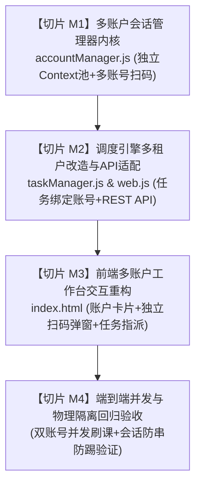

# 学习通多账户并发方案：切片化工程实施文档

> **文档版本**：v1.0.0 (Sliced Implementation Plan)  
> **制定日期**：2026-10-14  
> **工程规范要求**：遵循严格原子化交付、高内聚低耦合、各切片具备独立可测试与可验证性  
> **文档位置**：`c:\Users\Atta\Desktop\学习通\学习通多账户并发方案_切片化工程实施文档.md`

---

## 1. 方案背景与实施总体蓝图 (Overview & Slicing Matrix)

本方案旨在将现有的“单账户单会话”挂机服务，升级为**“支持多个超星账户同时登录、各自独立刷课、物理级隔离 Cookie、零会话串扰”**的企业级多租户并发挂机系统。

为了保证生产环境平稳升级、排查高效，整体工程细化拆解为 **4 个原子实施切片 (Slices M1 ~ M4)**：



| 切片编号 | 模块名称 | 核心改动文件 | 产出物与交付目标 | 验收标准 |
| :--- | :--- | :--- | :--- | :--- |
| **切片 M1** | **多账户会话管理器内核** | `vps-service/accountManager.js` (新建)<br/>`vps-service/data/accounts.json` (新建) | 独立的 `AccountManager` 类，管理 Playwright 多个 `BrowserContext` 实例池；支持多账户持久化与按账户独立扫码登录。 | CLI 运行单元脚本：成功创建2个独立账户档案，分别获取专属登录二维码并各自持久化独立 Cookies。 |
| **切片 M2** | **调度引擎改造与 REST API 扩充** | `vps-service/taskManager.js`<br/>`vps-service/web.js` | 任务实体增加 `accountId` 字段；调度器从账户上下文池获取 Page；新增 5 个 `/api/accounts/*` 接口，改造任务增删改查。 | API 级测试：可新增账户、拉取二维码、创建指定账户任务，并发调度正确指派到对应 Context。 |
| **切片 M3** | **前端工作台交互重构** | `vps-service/public/index.html` | 顶部新增多账户状态卡片流、添加账户/独立扫码弹窗；任务创建支持下拉选择账户；任务看板显示账户徽标。 | 浏览器操作测试：UI 清晰展示多个账户状态，可点击任一账户进行扫码，新建任务可选定账户。 |
| **切片 M4** | **端到端集成与防串号回归验证** | 整体系统集成 | 2 个账户同时分配活跃 Worker 挂机；执行视频播放、测验排错、跨账户会话隔离度检查。 | 两路任务同时推进视频播放且互相完全独立；无踢号、无 Cookie 覆盖；日志按账户清晰区分。 |

---

## 2. 切片 M1：多账户会话管理器内核 (AccountManager Core)

### 2.1 目标与架构设计
建立统一的账户会话生命周期管理模块 `accountManager.js`，实现与 Playwright Chromium 实例解耦的容器化上下文管理。

### 2.2 涉及文件变更
- **新建**：`vps-service/accountManager.js`
- **新建数据存储**：
  - `vps-service/data/accounts.json`：存放账户元数据列表；
  - `vps-service/data/auth_<accountId>.json`：各账户独立存放的 Session Cookies；
  - `vps-service/data/qr_<accountId>.png`：各账户独立的临时登录二维码图片。

### 2.3 核心实现规格
```typescript
class AccountManager extends EventEmitter {
    constructor(browser, dataDir)
    
    // 1. 数据持久化
    loadAccounts(): void
    saveAccounts(): void
    getAccount(accountId): AccountProfile
    listAccounts(): AccountProfile[]
    createAccount(name): AccountProfile
    deleteAccount(accountId): Promise<boolean>

    // 2. Playwright 上下文池化管理
    getOrCreateContext(accountId): Promise<BrowserContext>
    initAllContexts(): Promise<void>
    closeContext(accountId): Promise<void>

    // 3. 独立扫码认证流程
    requestQrLogin(accountId): Promise<string> // 返回 qrBase64
    waitForLoginSuccess(accountId, page): Promise<void>
    saveAccountCookies(accountId): Promise<void>
    checkAccountLoginStatus(accountId): Promise<boolean>
}
```

### 2.4 上下文物理隔离保证机制
```javascript
// 针对每个账户创建独立的 BrowserContext，禁止共享任何 Storage
const context = await this.browser.newContext({
    userAgent: 'Mozilla/5.0 (Windows NT 10.0; Win64; x64) AppleWebKit/537.36 (KHTML, like Gecko) Chrome/120.0.0.0 Safari/537.36',
    viewport: { width: 1280, height: 720 },
    ignoreHTTPSErrors: true
});
// 注入各账户自有的 Cookie 文件 (auth_acc_xxx.json)
if (fs.existsSync(cookieFile)) {
    const data = JSON.parse(fs.readFileSync(cookieFile, 'utf8'));
    if (data.cookies) await context.addCookies(data.cookies);
}
this.contexts.set(accountId, context);
```

### 2.5 验收标准与测试手段
- 编写测试脚本 `vps-service/test_m1.js`：
  1. 调用 `createAccount('测试账号1')` 与 `createAccount('测试账号2')`；
  2. 验证生成两个独立的 `BrowserContext`；
  3. 分别触发登录流程，确认生成的二维码文件各不相同；
  4. 检查各自生成的 Cookie 文件路径是否相互物理隔离。

---

## 3. 切片 M2：调度引擎多租户改造与 REST API 扩充 (Scheduler & API)

### 3.1 目标与架构设计
升级 `TaskManager` 与 `web.js`，将原本绑定的全局单 Context，改为根据任务所属的 `accountId` 动态指派对应的 `BrowserContext`，并开放完整的账户管理 RESTful API。

### 3.2 涉及文件变更
- **修改**：[vps-service/taskManager.js](file:///c:/Users/Atta/Desktop/学习通/vps-service/taskManager.js)
- **修改**：[vps-service/web.js](file:///c:/Users/Atta/Desktop/学习通/vps-service/web.js)

### 3.3 核心实现规格
#### 3.3.1 `taskManager.js` 改造点
1. **构造函数变更**：
   ```javascript
   constructor(accountManager, config, dataDir) {
       this.accountManager = accountManager; // 依赖注入账户管理器
       // 废除 this.context 全局单一上下文
   }
   ```
2. **`startTask(taskId)` 槽位分配逻辑重构**：
   - 提取任务 `task.accountId`；
   - 检查该账户是否存在且状态为 `LOGGED_IN`；
   - 若未登录：将任务状态置为 `PAUSED`，记录日志 `【启动失败】账户[xxx]未登录，请先扫码认证`；
   - 若已登录：通过 `await this.accountManager.getOrCreateContext(task.accountId)` 获取该账户专用上下文；
   - 实例化 `new TaskWorker(task, context, this.config, this.dataDir)`；
   - 启动 Worker 挂机流水线。

#### 3.3.2 `web.js` API 路由扩充
| HTTP 方法 | 接口路径 | 说明 | 请求体 / 响应 |
| :--- | :--- | :--- | :--- |
| `GET` | `/api/accounts` | 获取所有账户档案列表 | 返回 `{ accounts: AccountProfile[] }` |
| `POST` | `/api/accounts` | 创建新账户档案 | Body: `{ name: "李四" }` $\to$ 返回新账户信息 |
| `POST` | `/api/accounts/:id/qr-login` | 发起指定账户的独立扫码 | 返回 `{ success: true, qrBase64: "..." }` |
| `GET` | `/api/accounts/:id/status` | 查询指定账户当前登录态 | 返回 `{ id, status, realName }` |
| `DELETE`| `/api/accounts/:id` | 删除账户档案及相关 Cookies | 返回 `{ success: true }` |
| `POST` | `/api/tasks` | 创建任务（拓展） | Body 必填: `{ accountId, url, name, playbackRate }` |

### 3.4 验收标准与测试手段
- 使用 Node `fetch` 模拟多租户 API 交互：
  1. `GET /api/accounts` 返回现有账户；
  2. `POST /api/tasks` 提交属于不同 `accountId` 的两个挂机任务；
  3. 调用 `POST /api/tasks/:id/start` 启动两个任务；
  4. 验证调度器成功派发 2 个运行在各自独立 Context 下的 Worker，无报错无串号。

---

## 4. 切片 M3：前端多账户工作台交互重构 (Frontend Dashboard)

### 4.1 目标与架构设计
升级 `vps-service/public/index.html`，在保证现有单页响应式体验的基础上，提供直观、清晰的多账户卡片流、专属扫码弹窗以及任务-账户绑定可视化。

### 4.2 涉及文件变更
- **修改**：[vps-service/public/index.html](file:///c:/Users/Atta/Desktop/学习通/vps-service/public/index.html)

### 4.3 界面布局与交互设计
1. **多账户状态卡片栏（Account Strip）**：
   - 横向滚动/自适应卡片展示所有账户：
     - 账户备注名（如“张三”、“李四”）；
     - 状态指示灯（🟢 在线就绪 / 🟡 等待登录 / 🔴 异常失效）；
     - 快捷操作按钮（【扫码登录】、【删除】）；
     - 【➕ 添加新账户】卡片，点击弹出创建弹窗。
2. **专属扫码弹窗（Account QR Modal）**：
   - 独立弹窗标题：“正在为账户 [李四] 登录超星”；
   - 居中展示动态 Base64 二维码与绿色刷新倒计时；
   - 自动长轮询该账户状态，一旦扫码成功，弹窗自动关闭并弹出绿色 Toast 通知。
3. **任务创建表单关联选择**：
   - “选择归属账户”下拉框（自动装载已登录账户，默认选中第一个有效账户）；
   - 若未登录账户尝试创建任务，给出温和提示。
4. **任务看板增加账户标识**：
   - 每个任务卡片右上角增加彩色胶囊 Badge：`[👤 张三]`、`[👤 李四]`；
   - 支持按账户进行任务过滤查看。

### 4.4 验收标准与测试手段
- 打开浏览器访问 `http://127.0.0.1:3888`：
  1. 页面正确渲染账户管理卡片区；
  2. 点击“添加新账户”成功输入名称并显示新卡片；
  3. 点击“扫码登录”正确弹出专属二维码并在 App 扫码后自动关闭弹窗；
  4. 创建任务时可在下拉框中自由选择不同的账户；
  5. 任务卡片上准确标出账户名称。

---

## 5. 切片 M4：端到端集成与防串号回归验证 (E2E Verification)

### 5.1 目标与测试场景
验证 2 个及以上真实超星账户在同一台宿主机上同时并发刷课的稳定性与安全性。

### 5.2 核心测试用例矩阵
| 测试用例 ID | 测试项 | 操作步骤 | 预期结果 |
| :--- | :--- | :--- | :--- |
| **TC-M4-01** | **双账户登录态共存** | 账户 A 与 账户 B 分别扫码登录并持久化 Cookie。 | 两个 `auth_acc_*.json` 同时有效，重启 Node 服务后两个账户仍均处于 `LOGGED_IN` 状态。 |
| **TC-M4-02** | **双账户并发挂机** | 设置全局并发数为 `2`，启动账户 A 的任务 1 与 账户 B 的任务 2。 | 两个 Worker 同时处于 `RUNNING` 状态，视频进度各自独立递增（例如 A 在 92%，B 在 15%）。 |
| **TC-M4-03** | **物理会话防串扰检查** | 检查账户 A 与 账户 B 的 Page URL 与 DOM 个人信息。 | 账户 A 播放页的学生学号/姓名始终为 A，账户 B 始终为 B，绝不发生 Session 覆盖或互踢。 |
| **TC-M4-04** | **单账户故障隔离性** | 人为中断账户 B 的网络或触发账户 B 答题熔断。 | 账户 B 任务安全暂停，账户 A 挂机任务完全不受影响，继续正常播放并自动切节。 |

---

## 6. 回滚与容灾预案 (Rollback Strategy)

若在升级过程中遇到不可逆问题：
1. **数据平滑回滚**：现有单个账户数据保留在根目录 `auth.json`，在 `AccountManager` 首次启动时自动将其作为“默认主账号 (acc_default)”进行数据迁移，无缝兼容老用户。
2. **代码回退分支**：所有改动集中在 `accountManager.js` 与 `taskManager.js` 的构造解耦，若需降级，保留原有单账户调度方法即可。
