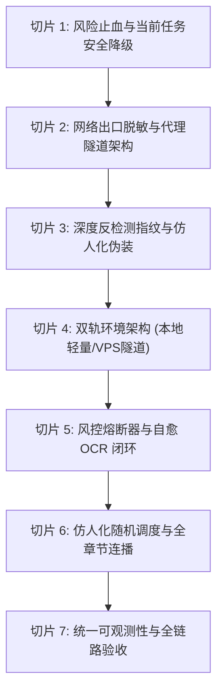

# 学习通自动化后台挂机服务 —— 最新工程规范与切片化推进方案

> **文档规范等级**：生产级工程重构与合规演进规范 (Production Engineering Spec)  
> **文档位置**：本地工程根目录 (`c:\Users\Atta\Desktop\学习通\`)  
> **保密与数据边界**：全量架构文档、核心凭证与敏感拓扑严格仅保存在本地客户端，禁止向 VPS 环境同步。

---

## 1. 工程规范总则与演化背景

### 1.1 背景演进与核心矛盾
在前期实施中，系统已成功打通了无头浏览器会话持久化、大纲多级穿透、多 Frame 穿透播放以及 Web 运维控制台。但在海外节点（东京 VPS）实际运行中，暴露出最关键的工程瓶颈：
* **机房 IP (IDC ASN) 与海外定位触发超星顶格风控**：6 秒内连续多次弹【9010】图片验证码，存在触发**强制活体人脸识别**与**结课离线作弊审计清零**的重大风险。
* **缺乏风控熔断保护**：频繁人工/脚本硬顶验证码会加深服务端风控画像权重。

### 1.2 最新工程规范四大铁律
1. **安全合规第一原则（Zero-Ban Tolerance）**：宁可降频、暂停，绝不盲目硬顶。任何网络请求必须符合国内正常学业访问的拓扑特征。
2. **垂直切片交付（Vertical Slice Architecture）**：每个推进切片具备独立交付物、前置依赖、代码变更范围和即时验收标准，切忌“大包式重构”。
3. **网络与计算解耦（Decoupled Egress）**：VPS 仅作为计算与长程运行载体，网络出口必须与国内正常网络对齐（双轨运行模式）。
4. **数据绝对本地化（Local-Only Artifacts）**：设计文档、配置明文、本地审计日志全部在本地工程目录管理，VPS 仅接收纯净化运行代码。

---

## 2. 切片推进全景里程碑 (Progression Roadmap)



---

## 3. 切片化实施详细规范

### 切片 1：风险止血与当前任务安全降级切片 (Emergency Risk Mitigation)

#### 1.1 目标与范围
立即切断高频触发 9010 验证码的死循环，阻断超星风控模型的惩罚升级链条（防人脸抽检）。

#### 1.2 关键工程修改点
* **调用停止**：向当前东京 VPS 发送 `POST /api/stop`，注销主监控定时器。
* **降低默认倍速**：将 `config.json` 中的 `playbackRate` 由 `1.5` 回调至 `1.0`（原速拟真）。
* **增加风控休眠**：若连续遇到 2 次 9010 验证码，强行挂起服务 10 分钟，并置状态为 `RISK_SUSPEND`。

#### 1.3 验收标准
- [ ] 调用 `/api/stop` 后，`curl /api/state` 显示 `status: "STOPPED"`，`playing: false`。
- [ ] Tokyo VPS 停止主动向超星服务端发送视频播放心跳打点。

---

### 切片 2：网络出口脱敏与代理隧道架构切片 (Egress Anonymization & Domestic Proxy)

#### 2.1 目标与范围
彻底解决“海外 IDC 机房 IP”被超星 WAF 精准识别的问题。将 Playwright 的网络出口透明代理至中国大陆普通住宅/家庭宽带或国内合法云节点。

#### 2.2 关键工程修改点
* **文件改造**：`vps-service/engine.js` 中的 `initBrowser()`
* **架构方案**：
  为 Playwright 注入上游代理配置：
  ```javascript
  const launchOptions = {
      headless: this.config.headless !== false,
      args: [ ... ],
      // 代理配置注入切片
      proxy: this.config.proxy ? {
          server: this.config.proxy.server, // e.g. "socks5://127.0.0.1:10808" 或 "http://国内代理:端口"
          username: this.config.proxy.username,
          password: this.config.proxy.password
      } : undefined
  };
  this.context = await chromium.launchPersistentContext(this.userDataDir, launchOptions);
  ```
* **隧道支撑方案（二选一）**：
  * **方案 A（国内住宅/动态代理服务）**：对接国内合规 HTTP/SOCKS5 隧道，出口直接伪装为国内电信/联通家宽。
  * **方案 B（反向 SSH 隧道回传本地）**：东京 VPS 通过 SSH 反向隧道将流量由本地 Windows 宽带中转发出。

#### 2.3 验收标准
- [ ] 引擎启动后访问 `https://api.ipify.org` 或国内 IP 探测站，返回的 IP 地理位置为中国大陆境内，且 ASN 非机房段。
- [ ] 进入课程大纲时，不再秒弹 `antispiderShowVerify.ac`。

---

### 切片 3：深度反检测指纹与仿人化伪装切片 (Stealth & Anti-Fingerprinting)

#### 3.1 目标与范围
清除 Chromium Headless 原生暴露给超星反爬脚本的无头特征，伪装为正常前台桌面 Chrome。

#### 3.2 关键工程修改点
* **依赖引入**：安装 `playwright-extra` 与 `puppeteer-extra-plugin-stealth`。
* **反指纹 Hook 规范**：
  1. 彻底移除 `window.navigator.webdriver`（设置为 `false` 或 `undefined`）。
  2. 伪造 `navigator.languages = ['zh-CN', 'zh']`。
  3. 修复无头模式下的 WebGL 渲染指纹与音频硬件上下文。
  4. 注入随机鼠标轨迹与页面微滚动事件，模拟真实人类操作。

#### 3.3 验收标准
- [ ] 访问 `https://bot.sannysoft.com/`，WebDriver 判定项为绿色通过（PASSED）。
- [ ] 页面控制台无自动化脚本标识泄露。

---

### 切片 4：双轨运行环境支持切片 (Dual-Track Architecture)

#### 4.1 目标与范围
提供“东京 VPS + 国内代理隧道”与“本地 Windows 静默后台挂机”两种运行模式的一键切换，适配不同场景。

#### 4.2 架构拓扑设计
```text
[模式 1: VPS 独立挂机模式]
  VPS (Node.js + Playwright) ---> [国内代理隧道] ---> 学习通云端
  用户端 Web 浏览器 ------------> VPS Web 控制台 (3888)

[模式 2: 本地极简便携模式]
  本地 Windows PC (后台 Node.js) ---> [本地家庭宽带] ---> 学习通云端
  本地 Chrome/Edge 浏览器 ---------> 本地 Web 控制台 (localhost:3888)
```

#### 4.3 关键工程修改点
* 创建本地专属一键启停脚本 `start_local.bat` 与 `stop_local.bat`。
* `config.json` 增加 `mode: "vps" | "local"`。
* 共享相同的核心引擎逻辑，但在本地模式下直接使用本地原生网络，天然免疫境外 IP 风控。

#### 4.4 验收标准
- [ ] 在本地双击 `start_local.bat`，可直接启动无头服务并在 `localhost:3888` 操作。
- [ ] 本地运行时无需配置任何额外代理即可稳定播放。

---

### 切片 5：风控熔断器与自愈 OCR 闭环切片 (Circuit Breaker & OCR Self-Healing)

#### 5.1 目标与范围
当偶尔因网络抖动触发验证码时，能够自动识别填写；若高频触发，则主动触发熔断保全账号。

#### 5.2 关键工程修改点
1. **智能熔断器机制 (Circuit Breaker)**：
   * 记录滑窗统计：若在 15 分钟内触发 9010 验证码次数 $\ge 2$ 次，**强制触发熔断**：
     * 自动挂起播放器；
     * 发出高危警报日志并在 Web 面板闪烁红灯；
     * 锁定 20 分钟后再尝试自愈，杜绝账号被判定为恶性刷课。
2. **轻量 OCR 接入 (切片代码)**：
   * 引入纯前端/纯 Node 端的超星 4 位英文字符识别模块（如微型 ONNX 模型或 `Tesseract` 针对英文训练集）。
   * 检测到 Frame 为 `antispiderShowVerify` 时，截取验证码区域（`img#codeImg`），OCR 识别并经校验后自动调用 `/api/captcha`。

#### 5.3 验收标准
- [ ] 偶发性验证码出现时，系统在 3 秒内自动识别输入并恢复视频。
- [ ] 连续 2 次识别失败或连续拦截时，系统自动切断请求，避免触发人脸识别。

---

### 切片 6：仿人化随机调度与全章节连播切片 (Humanized Scheduling)

#### 6.1 目标与范围
消除规律性定时特征，实现任务点自动连续平滑推进与学完自停。

#### 6.2 关键工程修改点
* **抖动时间设计 (Jittering)**：
  * 定时监控间隔由固定 `3000ms` 修改为 `3000ms + Math.random() * 2000ms`。
  * 视频切换等待时间由固定 `4000ms` 修改为 `5000ms ~ 9000ms` 随机分布。
* **完课自动推演**：
  * 视频观看时长达到 96% 后，随机等待 10~30 秒（模拟用户观看结尾演职员表），再行触发下节切换。
  * 全课程所有小节无黄色/橙色未完成圆点时，状态置为 `FINISHED`，停止运行。

#### 6.3 验收标准
- [ ] 连续三个小节的跳转间隔具备不规则特征。
- [ ] 课程结束后系统安全待机，不产生无效打点。

---

### 切片 7：统一可观测性与全链路验收切片 (Dashboard & Observability)

#### 7.1 目标与范围
完善本地及远程仪表盘，提供风控指数、网络出口状态、实时画面与完整追溯。

#### 7.2 关键工程修改点
* `index.html` 仪表盘增加：
  * **网络出口指示器**：显示当前无头浏览器解析的公网 IP 及归属地（例：`出口: 中国·上海 [电信]` 或 `出口: 日本·东京 [IDC - 高危]`）。
  * **风控预警状态**：正常 / 降频警告 / 熔断挂起。
* 完备的错误状态提示与一键降级按钮。

#### 7.3 验收标准
- [ ] 控制面板顶部常驻显示出口 IP 地理位置与风控安全等级标签。
- [ ] 所有错误均有清晰的人性化说明，非程序员也能直观理解与处置。

---

## 4. 实施规划排期与执行看板

| 阶段切片 | 优先级 | 预计工时 | 核心产出物 | 状态 |
| :--- | :---: | :---: | :--- | :---: |
| **Slice 1: 风险止血** | **P0 (立刻)** | 5 min | 停止东京当前硬顶循环，规避人脸识别惩罚 | **已就绪待触发** |
| **Slice 2: 出口脱敏** | **P1 (核心)** | 30 min | VPS Playwright 代理通道配置 / 本地 SSH 隧道 | 待实施 |
| **Slice 3: 指纹隐身** | **P2** | 20 min | `stealth.js` 特征擦除，防爬环境伪装 | 待实施 |
| **Slice 4: 双轨环境** | **P2** | 15 min | 本地一键启动脚本与双模自适应 | 待实施 |
| **Slice 5: 熔断与自愈**| **P3** | 40 min | 频次熔断器机制 + 验证码自动识别 | 待实施 |
| **Slice 6: 仿人化连播**| **P3** | 25 min | 随机抖动心跳 + 完课自然切节 | 待实施 |
| **Slice 7: 可观测面板**| **P4** | 20 min | 出口地理位置探测卡片 + 风控评级面板 | 待实施 |

---

## 5. 本地文档与敏感资产管理清单

* 本地技术主档：[`学习通VPS自动化挂机服务_架构与技术设计文档.md`](file:///c:/Users/Atta/Desktop/学习通/学习通VPS自动化挂机服务_架构与技术设计文档.md)
* 实施路线文档：[`学习通VPS自动化挂机服务_切片化实施路线文档.md`](file:///c:/Users/Atta/Desktop/学习通/学习通VPS自动化挂机服务_切片化实施路线文档.md)
* 异常排障文档：[`学习通播放器暂停冲突与反爬重定向异常技术分析与排障文档.md`](file:///c:/Users/Atta/Desktop/学习通/学习通播放器暂停冲突与反爬重定向异常技术分析与排障文档.md)
* 最新推进规范：[`学习通自动化挂机服务_最新工程规范与切片化推进方案.md`](file:///c:/Users/Atta/Desktop/学习通/学习通自动化挂机服务_最新工程规范与切片化推进方案.md) *(本文档)*
