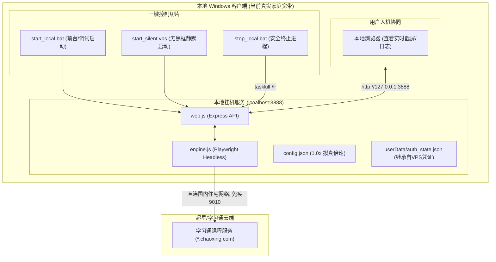

# 学习通本地双轨无头挂机服务 —— 架构与切片化实施方案

> **文档规范等级**：生产级工程实施规范 (Production Implementation Spec)  
> **文档位置**：本地工程根目录 (`c:\Users\Atta\Desktop\学习通\`)  
> **实施路线**：选项 A（本地双轨轻量无头静默挂机模式）  
> **保密与数据边界**：全量架构文档与配置仅保存在本地客户端，禁止向 VPS 同步。

---

## 1. 架构演进与方案背景

### 1.1 为什么转向“本地双轨模式”？
在此前实施中，东京 VPS 后台服务虽已完全具备 Playwright 驱动能力与 Web 控制台，但遇到了外部不可抗力的物理风控瓶颈：
* **海外 IDC 机房 IP 风控顶格**：超星云端 WAF 将东京机房 IP 列入高危机器爬虫模型，每隔数秒即下发【9010】操作异常验证码，存在诱发**强制活体人脸识别**和**结课作弊审计清零**的重大风险。
* **本地家庭宽带的天然安全护城河**：本地 Windows 电脑处于中国大陆真实住宅 ISP（家庭宽带）网络环境下，拥有合法的国内物理位置与住宅 ASN 标签，天然免疫绝大多数机房反爬与跨境风控规则。

### 1.2 本地双轨架构的核心原则
1. **代码复用与架构归一**：完全复用已验证完善的 `vps-service/`（`engine.js`、`web.js`、`public/index.html`），不重造轮子。
2. **静默后台，零前台干扰**：通过 Windows 脚本封装无头后台守护，不占用屏幕前台、不抢占鼠标键盘焦点、无黑色 CMD 弹窗打扰。
3. **凭证无缝迁移（热继承）**：直接回流东京 VPS 上的有效 Cookie 认证，免去重新扫码的流程。
4. **垂直切片落地**：按前置环境预检、凭证同步、静默批处理、全链路验收 4 个严密切片分步交付。

---

## 2. 系统拓扑与双轨架构设计



---

## 3. 分步骤切片化实施方案 (Sliced Implementation Plan)

### 切片 A1：本地运行环境预检与依赖就绪切片 (Environment Preflight)

#### 1.1 目标与范围
核验本地 Windows 机器上的 Node.js 环境、Playwright Chromium 浏览器依赖，确保服务具备一键启动条件。

#### 1.2 关键实施项
1. **Node.js 运行时检查**：核验本地 `node -v` (要求 $\ge 18.x$) 与 `npm -v`。
2. **依赖包完整性核查**：在本地 `vps-service/` 目录下检查 `node_modules`，确认 `playwright`、`express` 模块已就绪；若缺失则执行本地安装。
3. **端口排他性核验**：检查本地 `3888` 端口是否被其他进程占用。

#### 1.3 验收标准
- [ ] 本地执行 `node -v` 输出正常。
- [ ] 检查 `vps-service/` 具备完整运行依赖，无缺失模块。
- [ ] 本地 `3888` 端口空闲可用。

---

### 切片 A2：云端凭证热回流与会话热继承切片 (Session Hydration)

#### 2.1 目标与范围
将东京 VPS 刚刚成功认证并持久化的 37 个会话 Cookies 拉取回本地 `userData/` 目录，使本地挂机无需重新用手机扫码。

#### 2.2 关键实施项
1. **拉取远程凭证**：
   通过 SCP 从东京 VPS 获取文件：
   * `tokyo:/root/workspace/xuexitongScript/vps-service/userData/auth_state.json` -> 本地 `vps-service/userData/auth_state.json`
2. **凭证一致性校验**：
   解析本地 JSON，确认包含合法且未过期的超星主域 Cookies（如 `UID`、`_d`、`vc3`、`kns` 等）。

#### 2.3 验收标准
- [ ] 本地存在 `vps-service/userData/auth_state.json`。
- [ ] 启动时引擎输出：`已成功恢复历史登录凭证 (37 个 Cookies)` 与 `检测到已有效登录！`。

---

### 切片 A3：本地专属双轨配置与安全策略切片 (Local Config Tuning)

#### 3.1 目标与范围
调整本地 `config.json`，应用国内家庭宽带安全拟真策略，杜绝急躁参数。

#### 3.2 关键实施项
1. **参数固化**：
   ```json
   {
     "port": 3888,
     "playbackRate": 1.0,
     "autoAdvanceNoVideo": false,
     "courseUrl": "https://mooc1-2.chaoxing.com/mooc-ans/mycourse/studentcourse?courseId=266218537&clazzid=152328755&cpi=567218871&enc=f903cdfc871b6362dba4abbd72f045c3&fromMiddle=1&vc=1",
     "headless": true,
     "riskSuspendMinutes": 10,
     "maxConsecutiveCaptcha": 2
   }
   ```
2. **去代理直连**：本地模式显式不配置任何外部代理，直接走本地网卡直连国内教育网。

#### 3.3 验收标准
- [ ] 本地 `vps-service/config.json` 包含标准拟真 1.0 倍速与正确的课程大纲入口。

---

### 切片 A4：Windows 静默守护与一键运维脚本切片 (Silent Daemon Tooling)

#### 4.1 目标与范围
为用户打造如同系统服务般的极简 Windows 使用体验：支持双击后台静默运行、双击查看控制面板、双击一键停止。

#### 4.2 关键实施项
在本地项目根目录 (`c:\Users\Atta\Desktop\学习通\`) 创建 3 个控制工具：
1. **`启动挂机(后台静默).vbs`**：
   利用 Windows Script Host 的 `WScript.Shell.Run ..., 0, False` 特性，以纯后台零黑框方式启动 `node web.js`。
2. **`启动挂机(前台调试).bat`**：
   保留黑色 CMD 窗口，方便排查开发日志与断点信息。
3. **`停止挂机.bat`**：
   执行优雅终止：匹配并杀掉占用 `3888` 端口的本地 Node 进程与 Chromium 无头子进程。
4. **`打开控制台.bat`**：
   自动调用默认浏览器打开 `http://127.0.0.1:3888`。

#### 4.3 验收标准
- [ ] 双击 `启动挂机(后台静默).vbs` 后，桌面无多余黑框窗口，进程管理器中出现后台 `node.exe`。
- [ ] 浏览器访问 `http://127.0.0.1:3888` 能正常进入控制面板。
- [ ] 双击 `停止挂机.bat` 后，相关后台进程干净退出，端口释放。

---

### 切片 A5：本地端到端挂机运行与防卡全链路验收切片 (E2E Verification)

#### 5.1 目标与范围
在本地启动挂机服务，核验从加载课程大纲、自动定位小节、穿透 Frame 播放、到进度递增全流程，确认在家庭宽带下彻底告别【9010】验证码。

#### 5.2 关键实施项
1. **启动服务并触发挂机**。
2. **观察 5 分钟播放曲线**：
   * 记录视频播放秒数（从 80s 向后递增）；
   * 验证是否出现【9010】拦截；
   * 验证视频是否保持平稳推进；
   * 验证本地 Web 控制面板截图是否正常推流。

#### 5.3 验收标准
- [ ] 连续播放 5 分钟以上，无任何【9010】操作异常验证码弹窗。
- [ ] 视频进度稳定向前推移（80s -> 150s -> 300s...）。
- [ ] 本地 Web 控制台实时渲染清晰当前画面与健康日志。

---

## 4. 实施阶段核对表与看板

| 推进切片 | 优先级 | 产出成果 | 验证方式 | 状态 |
| :--- | :---: | :--- | :--- | :---: |
| **Slice A1** | P0 | 本地 Node.js 与依赖库检测 | 命令检查与 `npm list` | 待执行 |
| **Slice A2** | P0 | 从 Tokyo VPS 镜像最新 Session Cookie | `scp` 回传与文件核验 | 待执行 |
| **Slice A3** | P1 | 本地直连拟真配置生成 | 校验 `config.json` | 待执行 |
| **Slice A4** | P1 | 一键静默启动/停止工具脚本集合 | 本地脚本编写并测试双击体验 | 待执行 |
| **Slice A5** | P2 | 全链路端到端运行与 5 分钟稳定性验证 | 查看控制面板进度与日志 | 待执行 |
