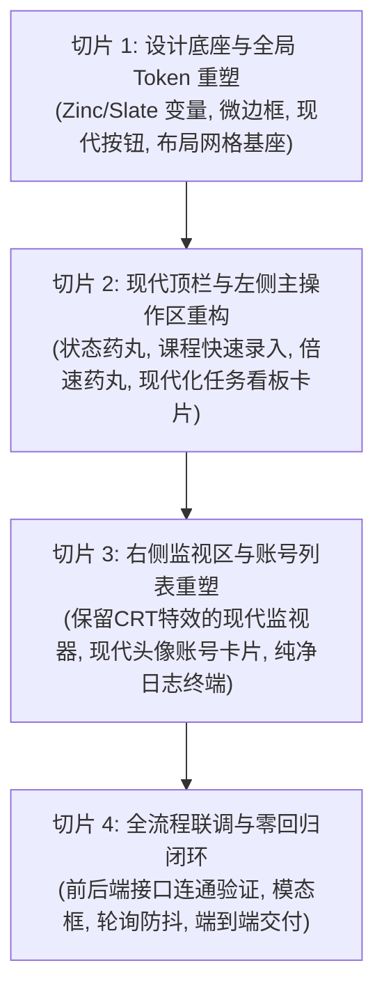

# XXT_TECH_现代化刷课控制台UI重塑与去模板化实施方案_v1.0.0

> **文档密级**：内部研发规范  
> **制定版本**：v1.0.0  
> **生效时间**：2026-10-14  
> **涉及系统**：学习通多租户智能并发挂机工作台（`vps-service/public/index.html`）  
> **指导方法论**：`distinctive-ai-design`（去模板化与真实意图定义） & `fullcycle-dev-practice`（切片化工程治理）

---

## 1. 架构背景与设计意图反思 (Intent & Retrospective)

### 1.1 业务本质的清醒回归
在前期美学探索中，系统曾一度陷入“为了设计而设计”的戏仿误区——将界面伪装成“19英寸工控机柜”、“电视台导播台”或“彭博金融终端”。这类方案虽然堆砌了复杂的螺丝、滑块、英文大写缩写与科幻名词，但**背离了系统的真实业务本质**：
- **本系统的真实身份**：一个专注高工效的**超星学习通多账号自动刷课控制面板**。
- **核心操作主线**：多租户账号挂载/扫码 ➔ 录入课程详情页链接 ➔ 设置播放倍速与并发线程 ➔ 挂机流水线执行（视频播放、AI 随堂做题、防封防退） ➔ 实时查看屏幕回传监视与排查日志。

### 1.2 核心去模板化原则（Distinctive AI Design 启示）
根据 `distinctive-ai-design` 的核心原则：
> **“模板感不来自某个单独样式，而来自缺乏意图和层级。界面不要假装成别的东西，做减法，让视觉选择紧紧围绕产品用途展开。”**

- **诚实不装（No Pretending）**：摒弃任何非必要的工业机柜、导播按键、假螺丝与假雷达。文案 100% 讲直白中文（“添加挂机课程”、“章节进度”、“播放倍速”、“AI 答题就绪”），去除所有为了凑版面的假科幻大写英文标签；
- **保留核心工效资产（Keep Loved Features）**：**明确保留用户高度认可的 CRT 屏幕微扫描线滤镜**。在做题监控视口中，CRT 4px 扫描线配合深色内嵌框能极其自然地压制网页截图的毛刺感，提供极具沉浸感的光学监看体验；
- **现代高质感布局（Modern Dashboard Layout）**：全面对标顶级现代开发者控制台（如 Vercel Dashboard、Supabase Console、Linear、Raycast），采用高对比度现代冷灰底色、1px 细微边界、有呼吸感且对齐严密的现代栅格。

---

## 2. 现代设计系统与 Token 规范 (Design Tokens)

### 2.1 现代暗色调色板 (Modern Zinc/Slate Palette)
系统将全面剔除此前廉价的蓝绿霓虹光晕（`box-shadow: 0 0 16px rgba(6,182,212,0.45)`），切换为沉稳、高对比、低噪点的现代工程调色：

```css
:root {
    /* 核心底色与卡片表面阶 */
    --xxt-bg-base: #090a0f;           /* 现代冷黑底色 (Zinc 950) */
    --xxt-bg-card: #11141c;           /* 主卡片底色 (Zinc 900) */
    --xxt-bg-card-hover: #161a24;     /* 卡片悬停底色 (Zinc 850) */
    --xxt-bg-card-subtle: #0d1017;    /* 内嵌沉降底色 (深沉内衬) */

    /* 现代微边框体系 (Hairline Borders) */
    --xxt-border-subtle: rgba(255, 255, 255, 0.08); /* 基础 1px 细线 */
    --xxt-border-medium: rgba(255, 255, 255, 0.14); /* 激活/悬停边框 */
    --xxt-border-focus: #0284c7;                    /* 聚焦高亮边框 */

    /* 业务主色调 (天空蓝 / 科技蓝) */
    --xxt-primary: #0284c7;
    --xxt-primary-hover: #0369a1;
    --xxt-primary-glow: rgba(2, 132, 199, 0.15);

    /* 状态指示语义色 (Semantic Signals) */
    --xxt-signal-success: #10b981;    /* 任务进行中 / 账号正常 (Emerald) */
    --xxt-signal-success-bg: rgba(16, 185, 129, 0.1);
    --xxt-signal-warning: #f59e0b;    /* 任务排队 / 待命就绪 (Amber) */
    --xxt-signal-warning-bg: rgba(245, 158, 11, 0.1);
    --xxt-signal-danger: #ef4444;     /* 错误 / 终止 / 验证码告警 (Rose) */
    --xxt-signal-danger-bg: rgba(239, 68, 68, 0.1);

    /* 现代文本阶梯 */
    --xxt-text-main: #f8fafc;         /* 标题与主要数值 (Slate 50) */
    --xxt-text-secondary: #94a3b8;    /* 章节与描述说明 (Slate 400) */
    --xxt-text-muted: #64748b;        /* 时间戳与辅助读数 (Slate 500) */

    /* 字体系统 */
    --font-ui: -apple-system, BlinkMacSystemFont, "Segoe UI", Roboto, "PingFang SC", "Hiragino Sans GB", "Microsoft YaHei", sans-serif;
    --font-mono: "JetBrains Mono", Consolas, "Courier New", monospace;

    /* 圆角与阴影 */
    --radius-sm: 4px;
    --radius-md: 8px;
    --radius-lg: 12px;
    --shadow-card: 0 4px 20px rgba(0, 0, 0, 0.25);
}
```

---

## 3. 现代化拓扑架构与版面布局 (Layout Architecture)

```
+-----------------------------------------------------------------------------------------------+
|  HEADER (顶栏): 学习通智能挂机控制台 | 🟢 运行中 · 家宽 IP: 114.220.89.14 | 并发选择器 | [全部启动] [全部暂停]   |
+-----------------------------------------------------------------------------------------------+
|                                                |                                              |
|  [主操作区 · 左侧 65%]                           |  [辅助监视区 · 右侧 35%]                       |
|                                                |                                              |
|  1. 快速添加挂机课程卡片 (Task Ingestion)         |  1. 实时屏幕监控 (保留 CRT 4px 微扫描线视口)      |
|     - 课程链接输入框 + [添加任务] 按钮           |     - LIVE 状态点 + [⛶ 放大看题] 按钮          |
|     - 关联账号下拉 + 倍速药丸切换器 [1.0x~2.0x]   |     - 真实截屏流 + 底部当前小节状态              |
|                                                |                                              |
|  2. 挂机任务看板 (Course Pipeline Deck)         |  2. 超星账号管理 (Account Deck)              |
|     - 统计指标：已完成 / 进行中 / 排队中        |     - 账号头像 Glyph + 学号/姓名 + 任务负荷     |
|     - 现代化课程卡片 (Task Cards):             |     - [+ 添加账号] 扫码弹窗入口                |
|       * 课程全名 + 状态徽章 (运行/排队/完成)    |                                              |
|       * 具体章节小节说明                       |  3. 实时运行日志 (Terminal Log Deck)         |
|       * 平滑双色双向进度条 (78.4% 节点比)       |     - 毫秒时间戳 + [播放/AI/调度] 级别标签     |
|       * 耗时等宽读数 + [暂停/置顶/删除] 动作组  |     - 自动跟随滚屏锁 + 一键清屏                 |
|                                                |                                              |
+-----------------------------------------------------------------------------------------------+
```

---

## 4. 关键交互与保留特性的现代化落地

### 4.1 屏幕监视器：优雅保留 CRT 特效
监视器将彻底抛弃假科幻 OSD 乱窜，但**完整保留其深受用户喜爱的 CRT 物理滤镜**：
- **容器结构**：
  ```css
  .crt-viewport-container {
      width: 100%;
      height: 230px;
      background: #040508;
      border-radius: var(--radius-md);
      border: 1px solid var(--xxt-border-medium);
      position: relative;
      overflow: hidden;
      display: flex;
      align-items: center;
      justify-content: center;
      box-shadow: inset 0 2px 10px rgba(0, 0, 0, 0.8);
  }
  .crt-viewport-container::after {
      content: "";
      position: absolute;
      top: 0; left: 0; right: 0; bottom: 0;
      background: linear-gradient(rgba(18, 25, 40, 0) 50%, rgba(0, 0, 0, 0.3) 50%);
      background-size: 100% 4px;
      pointer-events: none;
      opacity: 0.65;
      z-index: 5;
  }
  ```
- **纯净全屏弹窗**：点击“⛶ 放大看题”后呼出大图模态框时，去除扫描线滤镜，保证 100% 原图文字清晰度，方便学生核验题目。

### 4.2 课程任务卡片的现代视觉层级
- **标题行**：课程名称加粗（15px），紧随状态胶囊徽章（`badge-running`、`badge-queued`、`badge-account`、`badge-rate`）；
- **进度槽**：7px 极细平滑圆角轨道，渐变填充 `--primary` ➔ `--accent-green`；
- **等宽读数**：强制绑定 `font-variant-numeric: tabular-nums`，阻断 1s 轮询带来的排版横向跳变。

---

## 5. 前后端数据契约 100% 兼容性保证 (Contract Compatibility)

本次重构为纯视觉层与布局层演进，**严禁破坏任何既有前后端交互契约**。所有现有 DOM ID 和交互函数保持 100% 兼容：

| 关键 DOM 标识 / 函数 | 业务语义 | 兼容性保证策略 |
| :--- | :--- | :--- |
| `#taskListView` | 挂机任务卡片容器 | 保留 ID，升级内部 `renderTasks()` HTML 模板结构 |
| `#accountCardsView` | 超星账号卡片容器 | 保留 ID，升级内部 `renderAccounts()` HTML 模板结构 |
| `#livePreviewImg` | 实时屏幕截屏 `` | 保留 ID，包裹在现代 `.crt-viewport-container` 中 |
| `#logBoxView` | 终端日志滚动容器 | 保留 ID，保持 `renderLogs()` 推流更新 |
| `#concurrencySelect` | 全局并发数下拉选择 | 保留 ID 与 `change` 事件绑定 |
| `#urlInput` | 课程链接输入框 | 保留 ID 与回车/提交逻辑 |
| `#speedSelect` | 播放倍速选择器 | 保留底层 Select，药丸点击时同步触发原生 `change` 事件 |
| `#accountSelect` | 课程绑定的账号下拉 | 保留 ID，动态渲染可用账号选项 |
| `showToast()` | 全局战术通知总线 | 保留现代表单通知，无原生 `alert` 阻塞 |

---

## 6. 切片化实施路线图 (Slices & Milestones)

根据 `fullcycle-dev-practice` 规范，本次现代化 UI 重构将分为 4 个严密切片逐步推进：



- **切片 1（Token 与基座重塑）**：
  - 更新 `vps-service/public/index.html` 的 CSS 变量与基础排版，注入现代 Zinc/Slate 色阶；
  - 重构全局容器、栅格骨架（两栏 65% / 35%）与标准化按钮/输入框组件。
- **切片 2（顶栏与左侧主操作区）**：
  - 重构现代顶部导航（去除科幻标签，换上直白状态与控制项）；
  - 重构“添加挂机课程”卡片（带倍速药丸）；
  - 重写 `renderTasks()`，生成现代化的课程卡片、状态侧线与平滑进度槽。
- **切片 3（右侧监视区与账号列表）**：
  - 接入内嵌 CRT 4px 扫描线特效的现代屏幕监视器；
  - 重写 `renderAccounts()`，生成现代超星账号条目与状态徽章；
  - 优化日志控制台，统一显示中文直白业务标签。
- **切片 4（联调验证与零回归交付）**：
  - 启动真实挂机与扫码测试，验证任务创建、置顶、删除、放大查看做题截图等全流程；
  - 验证页面在不同分辨率下的响应式表现；
  - 同步更新生产环境归档。

---

## 7. 质量验收指标 (Definition of Done)

1. **零虚假中二感（100% 诚实直白）**：页面所有标题、按钮、标签均为正常直白中文，彻底消灭所有无关的伪科幻、伪硬件术语；
2. **保留 CRT 特效**：屏幕监控视口清晰具有 4px CRT 扫描线质感，且不影响大图弹窗查看题目；
3. **接口零破坏**：多账号创建、扫码轮询、任务增删置顶、日志拉取、并发调节 100% 正常运行；
4. **排版无抖动**：所有数值和时间均绑定等宽字体，1 秒轮询推流下无任何横向位移与闪烁。

---
*文档编制完成，待用户签署后启动切片 1 推进。*
