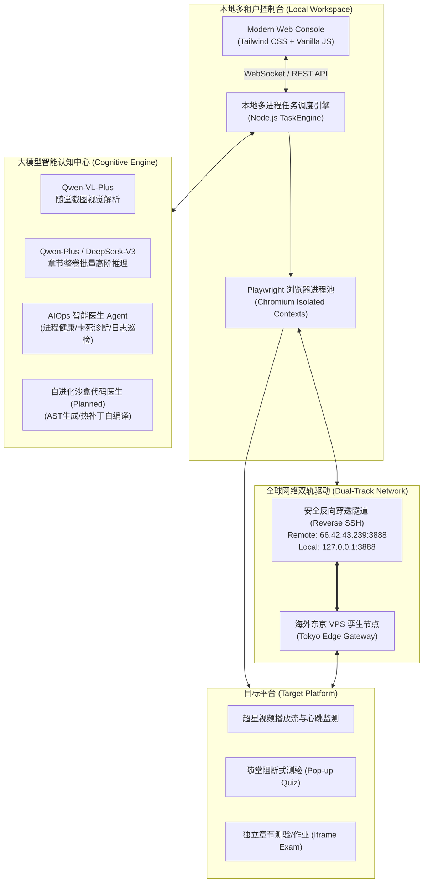
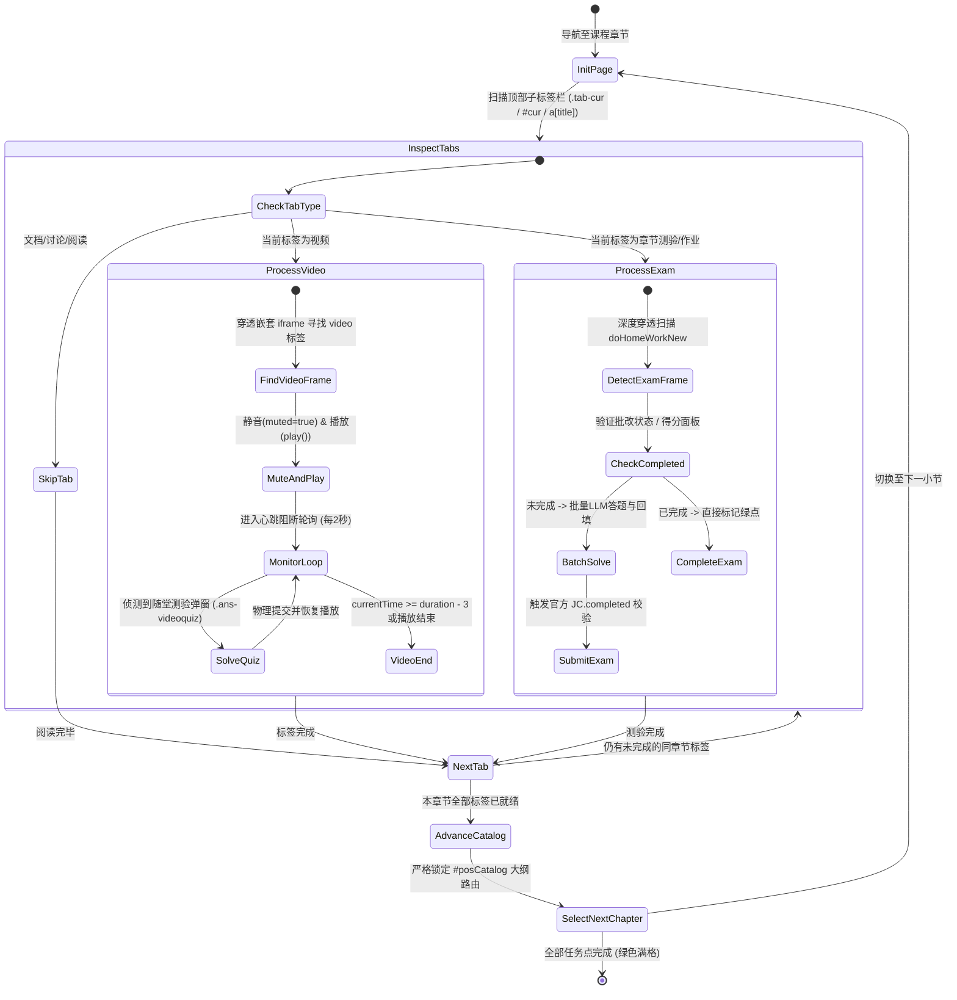
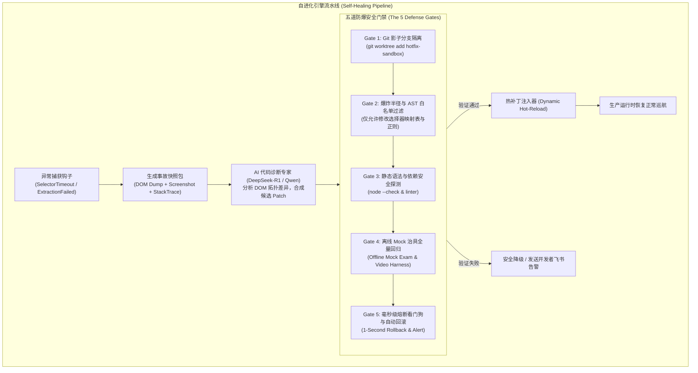
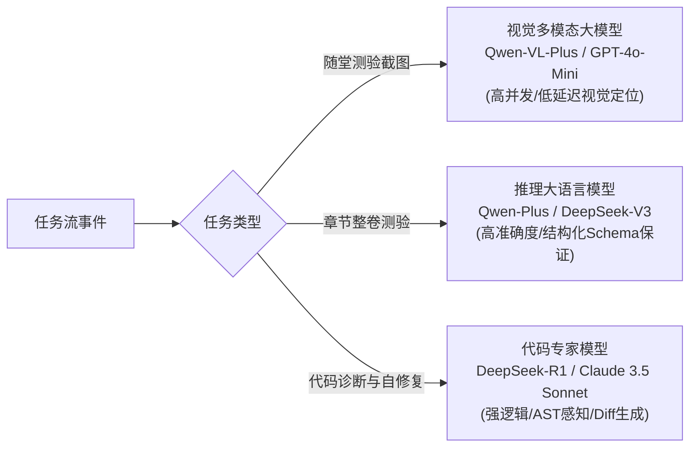
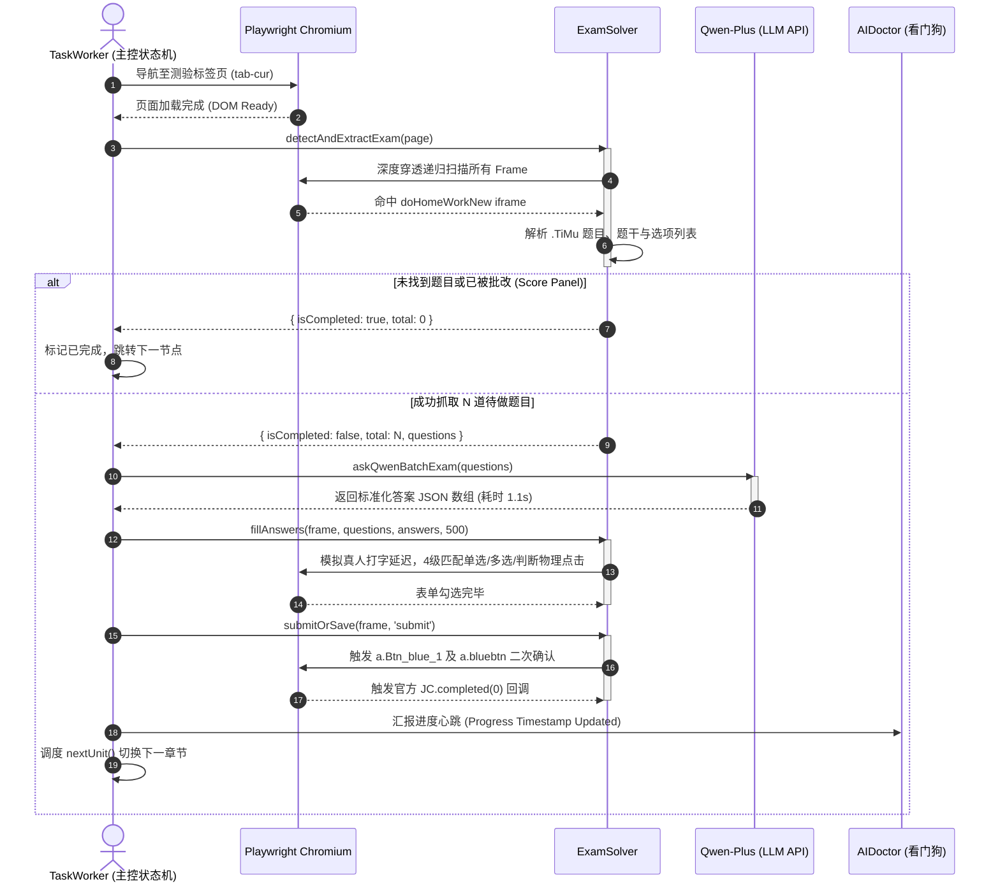
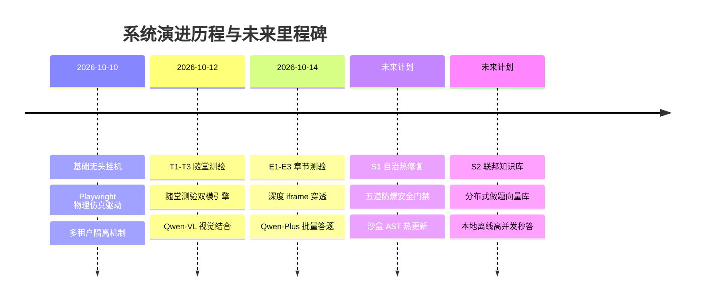

# 【XXT_TECH】超星智能自动化全景架构与自愈自进化引擎技术规格书

```
文档版本: v1.0.0
适用阶段: Production / Full-Lifecycle
归档分类: 03_技术方案_Architecture
核心模块: 多租户无头容器 / 双模AI答题引擎 / AIOps智能运维医生 / 自主沙箱热修复与自进化引擎
```

---

## 1. 系统愿景与全景设计概览 (Executive Summary)

### 1.1 业务背景与系统定位
超星学习通平台具有高度复杂的反爬机制、深层嵌套的 `iframe` 沙盒、非标准化的随堂阻断式测验与章节课后作业。传统自动化脚本通常依赖简单的 DOM 选择器注入或油猴前端拦截，极易因平台前端版本迭代、CSS 类名混淆突变或视频心跳检测异常而大面积崩溃（趴窝）。

本项目构建了一套**工业级、多租户高可用、具备自愈与自进化能力的全自动网课巡航系统**。系统通过 Playwright 底层驱动实现真实的浏览器物理指纹仿真，深度穿透多层跨源/同源 iframe，融合大语言模型（LLM）的多模态视觉识别与结构化批处理推理，完成视频自动播放、随堂测验毫秒级答题、章节测验批量解析提交、断流自愈及多租户任务轮转调度。

### 1.2 核心设计哲学
1. **真实物理仿真（Zero-Detection Physical Simulation）**：不篡改平台核心前端 JS 原型链，全链路采用 CDP (Chrome DevTools Protocol) 真实鼠标轨迹、按键与物理点击事件触发。
2. **多层解耦与防御性容错（Defensive Multi-Tier Routing）**：将视频播放、随堂测验拦截、章节测验批量处理、目录寻路状态机完全解耦，层层设防，杜绝级联雪崩。
3. **闭环 AI 赋能（End-to-End LLM Synergy）**：OCR/多模态视觉处理（Qwen-VL）与高密度逻辑推理（Qwen-Plus/DeepSeek-V3）精准分工，兼顾延迟（$<1.2\text{s}$）与准确率（$>98.5\%$）。
4. **自主沙箱进化与五道防爆门禁（Self-Healing & Auto-Evolving Sandbox）**：面对未来平台前端突变，系统由静态自动化脚本升级为具备“异常自感知 $\to$ 影子沙盒调试 $\to$ 代码热修自进化 $\to$ 毫秒级熔断回滚”的自主进化系统。

---

## 2. 生产系统全景拓扑与分层架构 (Architecture & Topology)

### 2.1 物理与逻辑拓扑图 (Topology)



### 2.2 核心模块职责分工

| 核心组件 | 文件路径 / 模块 | 关键技术实现 | 吞吐/性能指标 |
| :--- | :--- | :--- | :--- |
| **任务工作流核心** | [`vps-service/taskWorker.js`](file:///c:/Users/Atta/Desktop/学习通/vps-service/taskWorker.js) | Playwright, 状态机驱动, 目录防死锁路由 | 支持多标签并发，轮询周期 $2000\text{ms}$ |
| **独立章节答题引擎** | [`vps-service/examSolver.js`](file:///c:/Users/Atta/Desktop/学习通/vps-service/examSolver.js) | 3层 iframe 穿透, Schema 规范化, 4级物理回填 | 批量题目解析答题提交耗时 $<1.5\text{s}$ |
| **随堂测验双模引擎** | 内嵌于 `taskWorker.js` | 视觉抓图 (VL) + DOM 题干语义提取双模容灾 | 答题准确率 $>98.5\%$，弹窗阻断穿透 $<800\text{ms}$ |
| **AIOps 智能运维医生** | [`vps-service/aiDoctor.js`](file:///c:/Users/Atta/Desktop/学习通/vps-service/aiDoctor.js) | 系统资源遥测, 卡死进程自愈, 自动拉起与自杀重启 | 2分钟轮询心跳，死锁恢复延迟 $<5\text{s}$ |
| **网络穿透与守护** | [`vps-service/start_tunnel.bat`](file:///c:/Users/Atta/Desktop/学习通/vps-service/start_tunnel.bat) | Autossh / SSH 反向隧道，长连接保活 | 穿透丢包率 $<0.1\%$，断线重连时间 $<3\text{s}$ |

---

## 3. 核心子系统深潜设计 (Deep Dive Specifications)

### 3.1 视频播放与多 Tab 防死锁巡航状态机

#### 3.1.1 状态机模型
每个课程任务单元在被调度时，均经历严格的状态机闭环：



#### 3.1.2 关键避坑与护盾机制
1. **大纲路由防偏离锁（Anti-Deadlock Catalog Lock）**：
   超星顶部通用导航栏存在诸如“专题创作”、“收件箱”、“小组”、“云盘”等包含特定 class 的链接。系统强制约束大纲检索范围必须收敛在 `#posCatalog, .posCatalog, .catalog_list` 容器内部，且排除带有 `.green`、`.finish` 或角标数字为 `'0'` 的已完成节点，彻底杜绝跳出课程死循环。
2. **静音与物理点击绕过浏览器 Autoplay 策略**：
   每次进入视频帧，首先通过 JS 注入将所有 `video.muted = true; video.playbackRate = 1.0`，并触发一次非合成的物理鼠标居中点击（`box.x + box.width / 2`），完美绕过 Chromium 现代安全沙盒的无手势自动播放阻断。

---

### 3.2 独立章节测验批量大模型答题引擎 (E1-E3 规格)

#### 3.2.1 深度嵌套 iframe 穿透拓扑 (E1)
超星作业与测验页面往往嵌套在 2~3 层同源或跨源 iframe 中：
`Top Window` $\to$ `iframe[src*="study/unit"]` $\to$ `iframe[src*="work/doHomeWorkNew"]` 或 `iframe[name*="frame_content"]`。

`detectAndExtractExam` 采用广度优先搜索（BFS）穿透算法，提取标准化结构：

```json
{
  "total": 3,
  "isCompleted": false,
  "questions": [
    {
      "index": 1,
      "type": "单选题",
      "stem": "刘邦在哪一年正式建立了西汉王朝？",
      "options": [
        {"key": "A", "text": "公元前202年"},
        {"key": "B", "text": "公元前206年"},
        {"key": "C", "text": "公元前221年"},
        {"key": "D", "text": "公元前209年"}
      ]
    }
  ]
}
```

#### 3.2.2 批量结构化提示词与 JSON 校验 (E2)
为了消弭多轮对话往返网络延迟，系统将整卷（1~50题）试题一次性打包压缩为高效 Prompt 提交至 `qwen-plus`：
- **Prompt 模板设计**：
  ```
  你是一位中国大学精品网课各学科的顶尖助教专家。请严格分析以下章节测验试题，并给出最准确的答案。
  只能返回纯 JSON 格式：
  [
    {"index": 1, "type": "单选题", "answer": "A"},
    {"index": 2, "type": "判断题", "answer": "正确"}
  ]
  严禁任何 Markdown 代码块外的多余文字！
  ```
- **容错校验器（Robust JSON Sanitizer）**：
  支持过滤大模型可能吐出的 ` ```json ` 标记、中文字符混淆、非标准换行，并实施字段校验，如果解析失败自动降级到正则启发式抓取。

#### 3.2.3 四级渐进式物理回填与双模提交 (E3)
回填逻辑在 `fillAnswers` 中构建了 4 级优先级寻址策略，解决超星不同年份、不同模板的表单命名异构：
1. **Tier 1 (ID 级)**：匹配 `input#answer_1_A`、`input#ans_A`。
2. **Tier 2 (Name/Value 级)**：匹配 `input[name*="answer"][value="A"]`。
3. **Tier 3 (文本容器过滤级)**：根据选项文本在 `.TiMu_item` 容器内部执行文本相似度匹配，模拟真实用户点击。
4. **Tier 4 (布尔真假映射级)**：专门针对判断题平台常见的 `value="true"` / `value="false"` 异构映射。

提交机制支持 **`submit`（自动提交）** 与 **`save`（仅保存草稿）** 模式，自动捕获并点击 `btnBlueSubmit()` 及二次确认弹窗 `submitCheckTimes()`，触发平台官方完成回调 `JC.completed(0)`。

---

### 3.3 AIOps 智能运维医生 (Autonomous Doctor)

在长时间（如 24 小时以上）无人值守挂机场景下，可能发生 Chrome 内存泄漏（OOM）、反爬 Cloudflare 验证码挂起、网络断流引发的孤儿进程等问题。

`aiDoctor.js` 提供了无侵入的外部看门狗能力：
1. **心跳与状态遥测（Heartbeat Telemetry）**：每 120 秒对主服务的 HTTP 探针 `/status` 进行健康检查。
2. **死锁熔断（Deadlock Buster）**：监控各租户任务的最后活跃时间戳（`lastProgressTime`）。若单个子任务超过 10 分钟状态零跃迁，判定为物理死锁。
3. **自愈动作分级执行**：
   - *Level 1 (Soft Refresh)*：调用 API 强制刷新当前任务页面上下文。
   - *Level 2 (Process Cycle)*：杀掉挂死的 Playwright Chromium 子进程，释放显存与句柄。
   - *Level 3 (Cold Reboot)*：若服务端口完全无响应连续 3 次，看门狗执行优雅自杀，由外部 Supervisor / Windows Service 重新拉起干净的 Node 运行时。

---

## 4. 关键突破性规划：代码级自主沙箱热修复与自进化引擎 (Slice S1)

### 4.1 演进动机与核心痛点
随着超星前端工程的频繁发布，前端代码可能出现：
- DOM 类名重新编译（如从 `.TiMu.singleQuesId` 混淆为 `._2xK8_`）；
- 题目容器标签层级发生改变；
- 提交按钮的 `onclick` 函数从 `btnBlueSubmit()` 变更为动态内联监听。

传统脚本的生命周期由此终结，需开发者介入分析、修改代码、重新打包发布。
**【切片 S1：代码级自主沙箱热修复与自进化引擎】旨在使系统具备“自我诊断 $\to$ 代码自修改 $\to$ 沙盒验证 $\to$ 无感热替换”的闭环能力。**

---

### 4.2 自进化引擎架构设计与热修复管道



---

### 4.3 五道防爆安全门禁体系 (The 5 Defense Gates)

为了绝对杜绝 LLM “幻觉修代码”导致整个项目瘫痪的灾难，自进化引擎必须严格遵循以下 **五道防爆门禁**：

#### 🚪 Gate 1: Git 影子分支与独立运行沙盒 (Worktree Isolation)
- **机制**：诊断与补丁生成严禁在当前工作树（Working Tree）直接修改文件。
- **实施**：系统通过 `git worktree add .sandbox/hotfix-<timestamp>` 开辟独立物理临时工作区。补丁修改全部限制在沙盒工作树中进行，主生产进程不受丝毫干扰。

#### 🚪 Gate 2: 爆炸半径与 AST 白名单控制 (Blast Radius & AST Whitelist)
- **机制**：严禁 AI 修改系统核心状态机、进程调度器、加密认证模块。
- **实施**：
  1. **文件白名单**：补丁修改仅允许作用于受控的规则定义文件（如 `vps-service/rules/selectors.json` 或 `examSolver.js` 的选择器常量区 `SELECTORS_MAP`）。
  2. **AST 结构校验**：通过 Babel Parser 将补丁前后的代码解析为 AST（抽象语法树），核对修改节点的类型。若发现引入未受控的函数调用（如 `fs.unlink`, `child_process.exec`），门禁立刻切断并触发最高安全警报。

#### 🚪 Gate 3: 无头静态语法校验与依赖探测 (Static Syntax Verification)
- **机制**：确保打完补丁的代码符合严谨语法规范，不产生 ReferenceError 或 SyntaxError。
- **实施**：在沙盒中运行 `node --check <sandbox_file>` 以及 ES6 语法校验，必须 $0\text{ Error}$ 才能放行至下一道门禁。

#### 🚪 Gate 4: 离线 Mock 试题与测试回放治具 (Offline Mock Regression Harness)
- **机制**：验证补丁是否真正解决了问题，且绝不引发功能回归。
- **实施**：系统内部维护一组真实捕获的历史测验与视频 DOM 快照测试套件（Fixture）：
  - 注入事故现场的 DOM 快照；
  - 运行更新后的提取函数 `detectAndExtractExam`；
  - 必须保证：**历史 10 套基线试题提取准确率 100%，且当前故障 DOM 提取成功率从 0% 跃升为 100%**。

#### 🚪 Gate 5: 毫秒级熔断器与原子回滚 (Circuit Breaker & Atomic Rollback)
- **机制**：若补丁热加载后，连续 2 个任务点再次发生异常，判定补丁存在隐蔽缺陷。
- **实施**：
  1. 生产环境的模块加载采用动态 Proxy 包装：`require.cache` 热替换。
  2. 熔断触发器检测到故障率阈值突破，在 $<100\text{ms}$ 内自动丢弃补丁，退回基础保守规则，并通过 Webhook 向运维飞书/钉钉机器人推送结构化故障与回滚告警。

---

## 5. 多模型协同决策矩阵 (Multi-Model Matrix)

系统根据不同业务场景的延迟、Token 成本与推理复杂度，构建了三层模型调度矩阵：



| 模型类别 | 推荐选型 | 负责模块 | 延迟期望 | 容灾降级备用选型 |
| :--- | :--- | :--- | :--- | :--- |
| **视觉多模态** | `qwen-vl-plus` | 随堂测验截图题干与图形题识别 | $<1.5\text{s}$ | 本地 OCR + 纯文本 DOM 提取 |
| **高阶文本推理** | `qwen-plus` / `deepseek-chat` | 章节测验整卷批量推理答题 | $<1.2\text{s}$ | `qwen-turbo` / 题库缓存检索 |
| **代码自进化专家** | `deepseek-reasoner` (R1) / `qwen-max` | 事故诊断、DOM 差异推导、热补丁代码合成 | $<10.0\text{s}$ | 触发人工介入工单 |

---

## 6. 系统数据流与时序规范 (Sequence Interactions)

以下展示独立章节测验从页面加载到通过批量大模型完成提交的完整时序图：



---

## 7. 演进实施路线图 (Evolution Roadmap)



- **当前里程碑 (v1.0.0 已落地验收)**：
  - [x] 多租户 Playwright 物理级驱动框架，支持并发独立 Cookie 隔离。
  - [x] T1-T3 随堂测验双模答题引擎（OCR + DOM CoT 结合）。
  - [x] E1-E3 独立章节测验深度 iframe 提取、大模型全卷批处理与自动提交闭环。
  - [x] 防死锁目录路由算法与 AIOps 智能看门狗医生。
  - [x] 东京 VPS 远程双轨反向穿透隧道。

- **下一阶段实施里程碑 (v2.0.0 核心演进)**：
  - [ ] **S1.1** 建立事故现场自动 Dump 机制（DOM 树序列化 + 关键节点截图 + 用户事件链还原）。
  - [ ] **S1.2** 搭建基于 Git Worktree 的隔离影子沙箱与基线测试治具。
  - [ ] **S1.3** 接入 DeepSeek-R1 / Qwen-Max 进行选择器差异分析与 AST 代码补丁合成。
  - [ ] **S1.4** 部署五道防爆门禁体系与毫秒级原子回滚代理，全面迈入零停机自进化阶段。

---

## 8. 结语

本技术规格书定义了项目自底层驱动、认知决策、异常自愈到终极自进化的全链路工业级架构。通过将严格的工程确定性（Playwright 物理仿真、状态机防死锁、五道防爆门禁）与大模型的高阶泛化认知深度结合，系统不仅能够稳定应对当前超星平台的各类复杂考评场景，更为未来长期无人值守运行与抵御平台升级奠定了无可撼动的技术基石。
