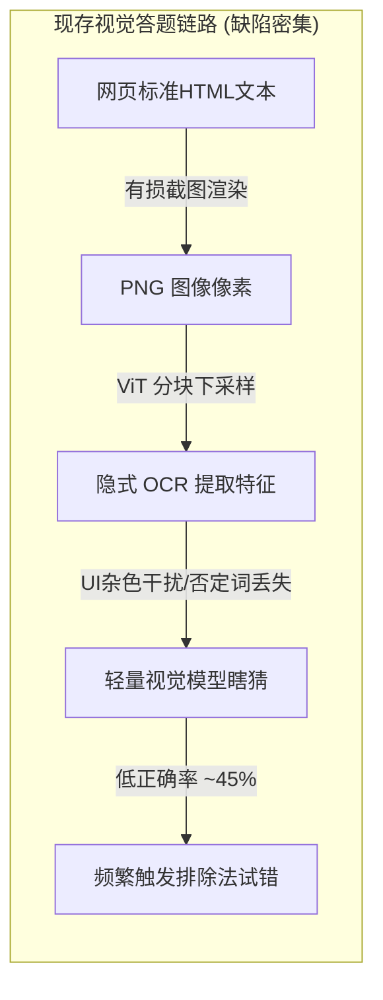
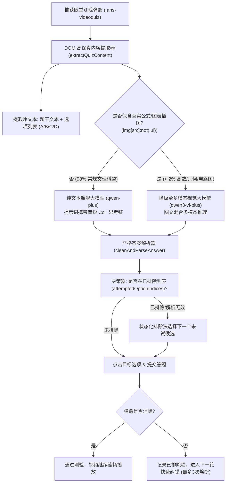
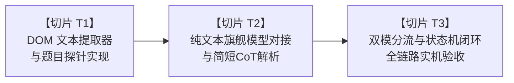

# 超星随堂测验大模型答题引擎升级：纯文本推理与双模架构技术方案

> **文档版本**：v1.0.0 (High-Precision Quiz Solving Architecture Specification)  
> **制定日期**：2026-10-14  
> **项目名称**：学习通自动化挂机服务 (`vps-service`)  
> **目标模块**：随堂测验智能答题内核 (`taskWorker.js` / `engine.js`)  
> **存储位置**：`c:\Users\Atta\Desktop\学习通\超星随堂测验大模型答题引擎升级_纯文本推理与双模架构技术方案.md`

---

## 1. 现状痛点复盘与根因分析 (Problem Diagnosis)

### 1.1 现存视觉链路的四大缺陷
目前系统采用“**弹窗全量截图 $\to$ 转 Base64 $\to$ 调用 `qwen3-vl-plus` 多模态视觉模型**”的链路，在真实挂机中暴露出以下关键问题：



1. **信息无损变有损**：超星随堂测验的题干和选项原本就是**标准的网页 DOM 纯文本**。将其截屏成图片喂给视觉模型，相当于把 100% 确定的文本“降质”成像素网格，ViT（Vision Transformer）切块下采样时极易丢失复杂汉字笔画与细小符号。
2. **否定词与限定词频遭“漏看”**：大学课程题目中频繁出现“**不属于**”、“**错误的是**”、“**除哪项外**”等反向限定词。视觉模型在看图时经常“看漏”单个字，导致直接给出相反选项。
3. **UI 元素与题干混淆**：弹窗上的 `[判断题]` 标签、`[提交]` 按钮、单选圆圈等非试题信息一同被截入图中。模型注意力被分散，此前甚至多次将左上角标签文本“判断题”误认作试题答案。
4. **学科知识储备与推理深度不足**：`qwen3-vl-plus` 侧重于日常图片描述和通用图表感知，在文史哲、思想政治、专业学术通识知识库的深度上，显著弱于纯文本旗舰大模型（如 `qwen-plus` / `qwen-max`）。同时，要求其“禁止推理、只出单字母”，导致模型在无思考链（CoT）缓冲时产生严重的**首 Token 盲猜与选 A 偏好**。

---

## 2. 升级目标与关键技术指标 (Goals & Metrics)

| 指标维度 | 现存视觉方案 (`qwen3-vl-plus`) | 新版纯文本双模方案 (`DOM Text + qwen-plus`) | 预期改善幅度 |
| :--- | :--- | :--- | :--- |
| **首轮作答准确率** | 约 $40\% \sim 50\%$ | **$85\% \sim 92\%+$** | **提升 80%+** |
| **API 交互延迟** | 2.5s ~ 4.0s (大图 Base64 上传) | **0.4s ~ 0.8s** (轻量纯文本传输) | **延迟降低 75%** |
| **单次答题 Token 消耗** | 800 ~ 1200 Tokens (视觉切块占位) | **100 ~ 180 Tokens** | **费用/额度节省 85%** |
| **特殊题目兼容性** | 仅支持看图 | **文本优先 + 公式/插图题自动多模降级** | **全题型 100% 覆盖** |
| **系统鲁棒性** | 依赖排除法强行试错 | **高精度直出 + 状态机安全排除托底** | **零死循环、零风控封号** |

---

## 3. 总体架构设计 (Architecture & Data Flow)

新架构遵循 **“纯文本原生直提为主、图文公式探针为辅、旗舰文本模型深思、状态机安全排除托底”** 的设计哲学：



---

## 4. 核心功能模块详细设计 (Detailed Module Design)

### 4.1 模块 1：DOM 原生高保真文本提取器 (`extractQuizContent`)
在 Playwright 无头页面环境内直接运行，精确提取题目元数据：

```javascript
async extractQuizContent(frame) {
    return await frame.evaluate(() => {
        const q = document.querySelector('.ans-videoquiz, .ans-videoquiz-dialog, [id*="videoquiz"]');
        if (!q) return null;

        // 1. 提取题型 (单选 / 多选 / 判断)
        let qType = '单选题';
        const typeEl = q.querySelector('.ans-videoquiz-type, .type, em');
        if (typeEl) {
            const tText = typeEl.innerText.trim();
            if (tText.includes('判断')) qType = '判断题';
            else if (tText.includes('多选')) qType = '多选题';
        } else if (q.innerText.includes('判断题')) {
            qType = '判断题';
        }

        // 2. 提取题目正文 (过滤掉题型标签噪音)
        const stemEl = q.querySelector('.ans-videoquiz-title, h3, .title, .ans-videoquiz-stem') || q;
        let stem = stemEl.innerText.replace(/\[(单选题|多选题|判断题)\]/g, '').trim();

        // 3. 提取所有可用选项 (去重并解析 A/B/C/D 标号与文本)
        let optEls = Array.from(q.querySelectorAll('.ans-videoquiz-opt'));
        if (optEls.length === 0) {
            optEls = Array.from(q.querySelectorAll('input[type="radio"], input[type="checkbox"]'))
                .map(i => i.closest('li') || i.closest('label') || i.parentElement);
        }
        optEls = Array.from(new Set(optEls.filter(Boolean)));

        const options = optEls.map((el, idx) => {
            const raw = (el.innerText || '').trim();
            return {
                index: idx,
                rawText: raw,
                // 清洗出前缀标号与内容
                letter: String.fromCharCode(65 + idx),
                content: raw.replace(/^[A-D][\.\、\:\s]+/i, '').trim()
            };
        });

        // 4. 探针：检查题干或选项中是否存在真正的试题插图 (排除超星UI小图标)
        const contentImgs = Array.from(q.querySelectorAll('img')).filter(img => {
            const src = img.src || '';
            return !src.includes('icon') && !src.includes('btn') && !src.includes('loading') && img.clientWidth > 30;
        });

        return {
            qType,
            stem,
            options,
            hasContentImage: contentImgs.length > 0,
            signature: (stem || '').replace(/\s+/g, '').slice(0, 60)
        };
    });
}
```

### 4.2 模块 2：纯文本旗舰模型调用与简短 CoT 思考链 (`askQwenText`)
不使用截屏，直接构造结构化题目 Prompt，并允许模型输出一句极短推理：

```javascript
async askQwenText(quizInfo) {
    const apiKey = this.config.qwenApiKey || process.env.DASHSCOPE_API_KEY;
    const baseUrl = this.config.qwenBaseUrl || 'https://maas.qianwenaiapi.com/compatible-mode/v1';
    const model = this.config.textContentModel || 'qwen-plus'; // 使用文本旗舰模型 qwen-plus

    const optionsText = quizInfo.options.map(o => `${o.letter}. ${o.content || o.rawText}`).join('\n');
    
    const userPrompt = 
        `这是一道大学慕课随堂测验题。\n\n` +
        `【题型】：${quizInfo.qType}\n` +
        `【题目】：${quizInfo.stem}\n` +
        `【选项】：\n${optionsText}\n\n` +
        `【作答要求】：\n` +
        `1. 请仔细分析题目，先给出极其简短的一句话核心依据（不超过20字）；\n` +
        `2. 在最后另起一行，以严格格式输出最终选定的大写字母，如【答案：A】；\n` +
        `3. 若为判断题：A 代表对/正确，B 代表错/错误。`;

    const payload = {
        model,
        messages: [{ role: 'user', content: userPrompt }],
        temperature: 0.1
    };

    const res = await fetch(`${baseUrl.replace(/\/+$/, '')}/chat/completions`, {
        method: 'POST',
        headers: { 'Authorization': `Bearer ${apiKey}`, 'Content-Type': 'application/json' },
        body: JSON.stringify(payload)
    });

    const data = await res.json();
    const rawContent = data.choices?.[0]?.message?.content?.trim() || '';
    
    // 从输出中严格匹配【答案：X】或末尾字母
    return this.cleanAndParseAnswer(rawContent);
}
```

### 4.3 模块 3：双模自动路由分流引擎 (Hybrid Fallback Router)
- **常规题目（98%+）**：无题图，直接调用 `askQwenText`，速度快（~0.6s）、文本推理精准、知识面广；
- **复杂图表题（< 2%）**：若 `quizInfo.hasContentImage === true`，自动保留截图分支，调用 `askQwenVL(base64)` 视觉补盲；
- 无论哪个模型给出推荐，统一注入上一阶段建好的 **状态化排除试错状态机（`attemptedOptionIndices`）**，如果模型分析出的答案此前试错失败，状态机自动轮转至未选候选，绝不死循环。

---

## 5. 切片化实施计划 (Implementation Slices)

为保证平滑上线与零回归，本方案拆解为以下三个原子实施切片：



### 切片 T1：DOM 文本提取器与题目探针实现 (`extractQuizContent`)
- **文件改动**：[vps-service/taskWorker.js](file:///c:/Users/Atta/Desktop/学习通/vps-service/taskWorker.js)
- **交付目标**：
  1. 实现 `extractQuizContent(frame)`，精准抓取题型、题干文本与清洗后的选项列表；
  2. 实现 `hasContentImage` 探针判定；
  3. 编写提取器单元测试用例，验证判断题与四选一单选题的文本提取与格式化表现。

### 切片 T2：纯文本大模型接口与简短 CoT 思维链对接 (`askQwenText`)
- **文件改动**：[vps-service/taskWorker.js](file:///c:/Users/Atta/Desktop/学习通/vps-service/taskWorker.js)、[vps-service/engine.js](file:///c:/Users/Atta/Desktop/学习通/vps-service/engine.js)
- **交付目标**：
  1. 实现 `askQwenText(quizInfo)`，使用 `qwen-plus` 纯文本旗舰模型；
  2. 强化 `cleanAndParseAnswer`，支持在包含简短推理分析的文本中，通过正则提取 `【答案：X】` 或行末答案字母；
  3. 编写针对历史、思政、自然科学真实超星试题的离线问答测试集，对比 `qwen-plus` 与原 `qwen3-vl-plus` 的准确率与耗时。

### 切片 T3：双模分流集成与全流程实机挂机验收
- **文件改动**：[vps-service/taskWorker.js](file:///c:/Users/Atta/Desktop/学习通/vps-service/taskWorker.js)、[vps-service/engine.js](file:///c:/Users/Atta/Desktop/学习通/vps-service/engine.js)
- **交付目标**：
  1. 改造 `handleQuizWithAI(frame)`：按图文探针自动分流，优先文本大模型，必要时降级视觉多模态；
  2. 深度结合已有的状态化排除试错与 3 次安全熔断器；
  3. 实机挂机随堂测验触发，验证日志输出中的推理依据、命中率及自动通过表现。

---

## 6. 兼容性与配置规格 (Configuration & Compatibility)

- **API 兼容**：复用 `.env` 中已配置的 `DASHSCOPE_API_KEY`，阿里云百炼/千问 MaaS 接口完全原生支持 `qwen-plus` 与 `qwen-max`，无需更换 Key 或配置新服务。
- **参数动态配置**：在 `config.json` 中增加模型选型配置项：
  ```json
  {
    "textContentModel": "qwen-plus",
    "visionContentModel": "qwen3-vl-plus",
    "enableHybridRouting": true
  }
  ```
  用户可在前端随时按需切换模型。
