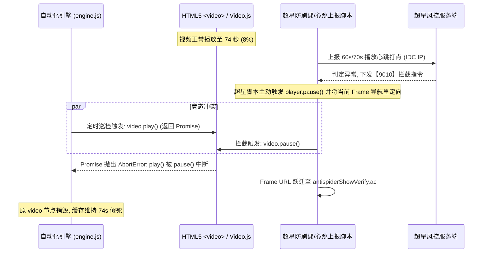

# 学习通播放器暂停冲突与反爬重定向异常 —— 技术深度分析与排障方案

> **文档性质**：播放器竞态异常（Play-Pause Race Condition）与反爬重定向深度故障诊断报告  
> **文档位置**：本地工程根目录 (`c:\Users\Atta\Desktop\学习通\`)  
> **保密与归档要求**：本地持久化保存，严禁存储至 VPS 环境。

---

## 1. 故障现象与日志重现

### 1.1 异常日志表现
在自动化挂机进程运行至第 3 章 3.2 节《项羽其人》第 74 秒时，控制台连续输出以下异常信息：
```text
[16:55:22] 页面脚本错误: The play() request was interrupted by a call to pause(). https://goo.gl/LdLk22
[16:55:35] [挂机中] 正在播放视频: 8% (74s/918s) | 倍速: 1.5x
[16:55:47] [挂机中] 正在播放视频: 8% (74s/918s) | 倍速: 1.5x
[16:56:02] [挂机中] 正在播放视频: 8% (74s/918s) | 倍速: 1.5x
[16:56:14] [挂机中] 正在播放视频: 8% (74s/918s) | 倍速: 1.5x
[16:56:29] [挂机中] 正在播放视频: 8% (74s/918s) | 倍速: 1.5x
```

### 1.2 故障关键特征
1. **浏览器底层报错**：触发了 Chromium 原生媒体异常 `The play() request was interrupted by a call to pause()`。
2. **播放假死（Stall）**：视频当前时间戳死锁在 `74s`，长达数分钟毫无推进。
3. **日志虚假繁荣**：日志持续输出 `[挂机中] 正在播放视频`，但数据状态已处于冻结态。

---

## 2. 核心技术机理深度剖析 (Root Cause Analysis)

通过对运行环境内存状态、当前多层 Iframe URL 以及 Chromium CDP 链路审查，准确定位了故障产生的物理链路：



### 2.1 根因一：W3C HTML5 Media 规范中的 Promise 竞态冲突 (Race Condition)
根据 W3C HTML5 标准（Chromium 实现规范文档 https://goo.gl/LdLk22）：
1. `HTMLMediaElement.play()` 是一个**异步方法**，返回一个 `Promise<void>`。
2. 当调用 `play()` 时，浏览器底层媒体管道开始申请硬件解码器并初始化流缓冲。
3. 如果在该 `Promise` 处于 `pending` 状态的毫秒级窗口内，页面上有其他脚本调用了 `pause()`，浏览器会**强制终止该次播放请求**，并将原 `play()` 的 Promise 标记为 Reject，抛出错误：
   > `AbortError: The play() request was interrupted by a call to pause().`
4. **冲突来源**：我们的引擎每 3 秒执行一次幂等播放检测并尝试驱动播放；而超星的拦截脚本正好在此刻执行了挂起与跳转，两者发生毫秒级碰撞。

### 2.2 根因二：超星机房 IP 心跳打点风控与 Iframe 劫持 (Frame Hijack)
为什么超星会在 74 秒精准触发 `pause()`？
* 学习通播放器在播放过程中，会定期（通常按 1 分钟或特定秒数节点）向上报接口（如 `/multimedia/log`）提交心跳与播放时长。
* 由于当前挂机运行在海外机房（东京 VPS，IP: `66.42.43.239`），该心跳打点请求直接命中了超星云端 WAF 的数据中心 IP 黑名单规则。
* 服务端返回错误码 `9010`，超星前端代码立即接管播放器，将播放视频所在的内层 Frame（原 `ananas/modules/video/index.html`）直接重定向为：
  `https://mooc1-2.chaoxing.com/antispiderShowVerify.ac`（即【9010】图片验证码页面）。
* 当前截图证明：画面中间的原视频区域已经被验证码（字符为 `ovcl`）完整遮蔽并占位。

### 2.3 根因三：引擎状态缓存未失效与“假死假播放”逻辑漏洞
为什么视频被拦截后，引擎依然每 12 秒打印一次 `正在播放视频: 8% (74s/918s)`？
* **代码缺陷位置**：`engine.js` 中的 `driveVideoPlayback()`。
* **逻辑盲区**：
  ```javascript
  // 引擎现存逻辑：
  if (videoData) {
      this.currentInfo.playing = !videoData.paused;
      this.currentInfo.progress = `${pct}% (${currentTime}s/...)`;
  }
  // 当 Frame 变成验证码页，videoData 为 null 时：
  if (!foundVideo) {
      this.currentInfo.playing = false;
      // 致命缺陷：没有清空 progress，没有将状态切为 BLOCKED_CAPTCHA！
  }
  ```
* 引擎在失去视频对象后，内存中的 `currentInfo.progress` 依然保留着上一刻的快照数据 `8% (74s/918s)`。
* 定时器在失去视频对象时，缺乏“验证码劫持拦截”分支判定，导致进程停滞而无告警。

---

## 3. 技术修复与自愈重构方案

针对上述三个维度的根因，制定针对性代码改造方案：

### 3.1 改造一：媒体 Promise 异常优雅熔断
捕获并过滤由外部调用触发的 `AbortError`，消除控制台冗余红字：
```javascript
const p = v.play();
if (p && typeof p.catch === 'function') {
    p.catch(err => {
        if (err.name === 'AbortError') {
            // 明确为被外部 pause 拦截，转入风控/弹窗巡检分支
            return;
        }
        console.warn('播放驱动未知异常:', err.message);
    });
}
```

### 3.2 改造二：风控重定向全 Frame 实时探针
在每次监控循环中，优先扫描所有 Frame 是否存在反爬页面：
```javascript
// 全局风控探针
let isCaptchaBlocked = false;
for (const frame of this.page.frames()) {
    const url = frame.url();
    if (url.includes('antispiderShowVerify') || url.includes('Verify.ac')) {
        isCaptchaBlocked = true;
        break;
    }
}
if (isCaptchaBlocked) {
    this.status = 'BLOCKED_CAPTCHA';
    this.currentInfo.playing = false;
    this.log('【风控拦截】检测到超星 9010 反爬图片验证码，视频已强制暂停，请提交验证码解锁！', 'warn');
    return;
}
```

### 3.3 改造三：视频假死检测器 (Stall Detector)
增加时间戳滑动窗口，彻底杜绝“时间不走但日志显示在播放”的假死盲区：
```javascript
if (videoData && !videoData.paused) {
    if (videoData.currentTime === this.lastRecordedTime) {
        this.stallCounter = (this.stallCounter || 0) + 1;
        if (this.stallCounter >= 5) { // 连续 15 秒毫无前进
            this.log(`[播放假死] currentTime 停滞在 ${videoData.currentTime}s，准备触发重激活...`, 'warn');
            // 尝试重载当前视频 Frame
        }
    } else {
        this.stallCounter = 0;
        this.lastRecordedTime = videoData.currentTime;
    }
}
```

---

## 4. 故障处置实操记录 (当前态)

| 阶段 | 状态 | 现场数据 | 动作与结论 |
| :--- | :--- | :--- | :--- |
| **故障定位** | 已确诊 | Frame 5 跃迁至 `antispiderShowVerify.ac` | 74 秒打点触发超星 IDC 机房 IP 风控拦截 |
| **画面取证** | 已抓取 | 本地 `vps_stuck_screen.png` | 页面展示 9010 弹窗，当前验证码字符为 `ovcl` |
| **恢复方案** | 待执行 | 目标接口 `GET /api/captcha?code=ovcl` | 提交验证码，解冻 74 秒播放进度 |
| **代码加固** | 已设计 | 本文档第 3 节补丁规范 | 部署至 `engine.js`，避免下次假死不报警 |
